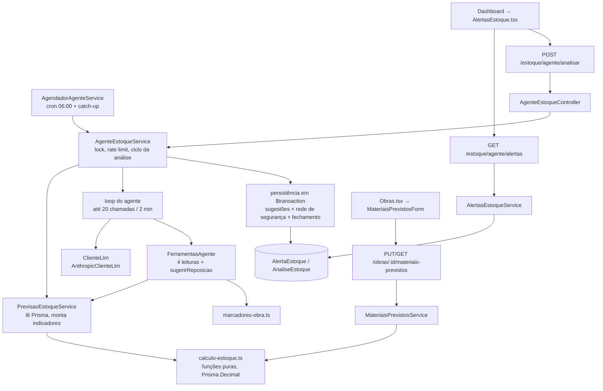

# Estoque — Agente Proativo de Reposição Design

**Spec**: `.claude/specs/features/estoque-agente-proativo/spec.md`
**Status**: Draft

---

## Abordagem do loop do agente

Todas as opções entregam o mesmo escopo; muda só quem controla o loop de tool use.

| Opção | Como funciona | Prós | Contras |
| --- | --- | --- | --- |
| **A. Loop manual sobre uma interface `ClienteLlm` (recomendada)** | O service chama `client.messages.create` em `while`, executa as ferramentas, conta chamadas e confere o relógio a cada iteração | Controle exato do limite de **20 chamadas de ferramenta** (não de turnos) e dos **2 min**; cada passo vai para `AnaliseEstoque.passos` no momento em que acontece; os testes trocam `ClienteLlm` por um roteiro determinístico, sem mockar o SDK; não depende de API beta | Mais código nosso (~80 linhas de loop) |
| B. Tool Runner do SDK (`client.beta.messages.toolRunner`) | O SDK roda o loop; as ferramentas viram `betaZodTool` | Menos código de loop | `max_iterations` conta turnos, não chamadas; parar no meio por tempo e manter as sugestões aceitas exige hooks; API beta; mock de teste fica acoplado ao SDK; acrescenta `zod` |
| C. Managed Agents | A Anthropic hospeda o loop e o ambiente | Zero loop no nosso código | Os dados do estoque teriam de ir para um sandbox externo; exagero para 5 ferramentas; difícil de testar offline |

**Recomendação: A.** Os limites da spec (20 chamadas, 2 min, status `PARCIAL` mantendo o que foi aceito) e a regra "testes nunca chamam a API" são exatamente o que o loop manual controla melhor.

---

## Architecture Overview



Fluxo de uma análise:

1. `AgenteEstoqueService.analisar(origem)` checa o lock em memória, fecha análise travada (> 5 min), aplica o limite de 5 min da manual e cria `AnaliseEstoque` `EM_ANDAMENTO`.
2. `PrevisaoEstoqueService.montarSnapshot()` lê materiais, movimentações, previstos e alertas recentes uma vez e calcula os indicadores de cada material. As ferramentas leem esse snapshot (os números não mudam no meio da análise).
3. O loop roda com a `ClienteLlm`. Cada `sugerirReposicao` aceita entra numa lista em memória; nada é gravado durante o loop.
4. Ao fim (sucesso, limite, falha ou recusa), uma única `$transaction` grava as sugestões aceitas, roda a rede de segurança, aplica silêncio/reabertura, fecha alertas não repetidos (só em `SUCESSO`/`PARCIAL`) e finaliza a `AnaliseEstoque`.
5. Nenhum caminho chama `material.update` nem `movimentacaoEstoque.create`.

---

## Code Reuse Analysis

### Existing Components to Leverage

| Component | Location | How to Use |
| --- | --- | --- |
| Padrão service + spec com Prisma mockado | `apps/api/src/obras/obras.service.ts`, `obras.service.spec.ts` | Modelo de todos os services novos e seus testes (`$transaction` mock que executa o callback com o próprio mock) |
| `EstoqueService.listarMateriais` / regra `<=` | `apps/api/src/estoque/estoque.service.ts:21`, `:107` | EST-08 fica intacta; o agente não a reutiliza para não acoplar as duas regras (Out of Scope) |
| Validação de DTO aninhado | `apps/api/src/obras/dto/create-obra.dto.ts` (`gesseiros` com `ValidateNested`) | Mesmo formato para `materiaisPrevistos` |
| Guard JWT global | `apps/api/src/app.module.ts:27` | Rotas novas já exigem login (AD-002) |
| `ConfigModule` global | `apps/api/src/app.module.ts:15` | Ler `ANTHROPIC_API_KEY`, `ANTHROPIC_MODEL`, `AGENTE_AUTOMATICO` via `ConfigService` |
| Cliente HTTP `api` e `ApiError` | `apps/web/src/lib/api.ts` | Ganha `put`; erros já chegam com a mensagem da API |
| Padrão `erro` / "Carregando..." | `apps/web/src/pages/Dashboard.tsx` | Mesmo padrão dentro da seção de estoque |
| Formulário dentro do card (`<details>`) | `apps/web/src/pages/Obras.tsx:165` (`AlocarGesseiroForm`) | Ação "Materiais previstos" |
| Formulários com teste | `apps/web/src/components/forms/*.test.tsx` | Estilo dos testes dos componentes novos |

### Integration Points

| System | Integration Method |
| --- | --- |
| Prisma schema | 3 modelos e 6 enums novos; relações novas em `Material` e `Obra`; uma migration |
| `ObrasService.create` | Aceita `materiaisPrevistos` e grava aninhado na mesma operação |
| `ObrasController` | Rotas `GET`/`PUT /obras/:id/materiais-previstos` delegando para `MateriaisPrevistosService` |
| `AppModule` | Registra `ScheduleModule.forRoot()` e `AgenteEstoqueModule` |
| `Dashboard.tsx` | Renderiza `<AlertasEstoque />` abaixo da grade do funil |
| Claude API | `@anthropic-ai/sdk`, `messages.create` com `tools`; chave e modelo do `.env` |
| docker-compose / `.env.example` | Repassam `ANTHROPIC_API_KEY`, `ANTHROPIC_MODEL`, `AGENTE_AUTOMATICO` ao container `api` |

---

## Components

### calculo-estoque (funções puras)

- **Purpose**: Implementar as fórmulas da spec sem I/O, para que cada regra seja testada 1:1.
- **Location**: `apps/api/src/estoque/calculo-estoque.ts`
- **Interfaces**:
  - `utilizadoObra(saidas: Decimal, entradas: Decimal): Decimal` — `max(0, saídas − entradas)`
  - `pendenteObra(previsto: Decimal, utilizado: Decimal): Decimal` / `excedenteObra(...)`
  - `diasJanela(criadoEm: Date, agora: Date): number` — `max(7, min(30, dias inteiros))`
  - `calcularIndicador(entrada: EntradaIndicador): IndicadorMaterial` — `reservado`, `saldoLivre`, `ritmoDiario`, `diasAteMinimo | null` (piso 0, nunca negativo; null com ritmo 0), `calculado`, `obrigatorio`, `motivo: 'ABAIXO_DO_MINIMO' | 'NO_MINIMO_COM_CONSUMO' | 'PREVISAO' | null` (`ABAIXO_DO_MINIMO` = saldo livre < mínimo; `NO_MINIMO_COM_CONSUMO` = saldo livre = mínimo com ritmo > 0, texto na UI "no mínimo"; `PREVISAO` = ritmo > 0 e `diasAteMinimo` <= 7; `null` = sem motivo)
- **Dependencies**: `Prisma.Decimal` (decimal.js, já vem com `@prisma/client`)
- **Reuses**: nada; é a fonte única das fórmulas (usada pela análise e pelo previsto × utilizado)

### PrevisaoEstoqueService

- **Purpose**: Ler o banco uma vez e montar o snapshot de indicadores por material.
- **Location**: `apps/api/src/agente-estoque/previsao-estoque.service.ts`
- **Interfaces**:
  - `montarSnapshot(agora: Date): Promise<SnapshotEstoque>` — materiais com indicador, obras que reservam cada material, previsto × utilizado das obras com previsão, último alerta de cada material (para silêncio/reabertura), exposto como `ultimosAlertas` (último alerta de cada material por tipo; as regras de silêncio e reabertura ficam em T6/T8)
- **Dependencies**: `PrismaService`, `calculo-estoque`
- **Reuses**: padrão de leitura de `EstoqueService`
- **Regras aplicadas aqui**: consumo solto = SAIDAs da janela sem `obraId`, ou de obra não `CANCELADA` sem previsão **para aquele material**; reservado = Σ pendente das obras `FECHADA`/`ANDAMENTO`; utilizado considera SAIDA − ENTRADA com `obraId` de todo o histórico.

### marcadores-obra

- **Purpose**: Esconder as obras da LLM e restaurar os títulos depois.
- **Location**: `apps/api/src/agente-estoque/marcadores-obra.ts`
- **Interfaces**:
  - `class MapaMarcadores { marcar(obraId, titulo): string; marcadorDe(obraId): string | undefined; titulo(marcador): string | undefined; paraJson(): Record<string, string> }` — `{{OBRA_1}}`, `{{OBRA_2}}`… na ordem em que aparecem; `marcadorDe` diz se o texto cita uma obra que reserva
  - `finalizarJustificativa(texto, mapa, obrasQueReservam, textoPadrao): { texto, origemTexto }` — `textoPadrao` vem do chamador (T8), que conhece os números do material; qualquer `{{…}}` que não seja marcador emitido → `textoPadrao` (`PADRAO`); sem nenhum marcador das obras que reservam → mantém e acrescenta "Reservado para: A, B." com ponto final (se o texto do agente não termina em ponto, acrescenta ". " antes); senão troca marcadores pelos títulos
- **Dependencies**: nenhuma

### ClienteLlm / AnthropicClienteLlm

- **Purpose**: Isolar o SDK atrás de uma interface pequena, trocável por roteiro nos testes.
- **Location**: `apps/api/src/agente-estoque/cliente-llm.ts`
- **Interfaces**:
  - `interface ClienteLlm { disponivel(): boolean; enviar(req: { system: string; tools: Anthropic.Tool[]; messages: Anthropic.MessageParam[]; signal: AbortSignal }): Promise<Anthropic.Message> }`
  - token de injeção `CLIENTE_LLM`
  - `AnthropicClienteLlm`: `disponivel()` = `ANTHROPIC_API_KEY` não vazia; `enviar` usa `messages.create({ model: ANTHROPIC_MODEL ?? 'claude-haiku-5-5', max_tokens: 16000, system, tools, messages }, { signal })` — 16000 porque o raciocínio adaptativo do Haiku 5.5 conta no `max_tokens`; com 4096 a resposta pode parar em `max_tokens` e virar `FALHA` (aprovado na revisão da Fase 2)
- **Dependencies**: `@anthropic-ai/sdk`, `ConfigService`
- **Notas**: sem `thinking` explícito (Haiku 5.5 usa adaptativo por padrão); o histórico é só acrescentado (`response.content` inteiro de volta), nunca editado, como exige a API para blocos de raciocínio.

### FerramentasAgente

- **Purpose**: Definir as 5 ferramentas e executá-las contra o snapshot.
- **Location**: `apps/api/src/agente-estoque/ferramentas-agente.ts`
- **Interfaces**:
  - `definicoes: Anthropic.Tool[]` — `listarMateriais`, `consumoDoMaterial(materialId)`, `reservadoPorObras(materialId)`, `previstoVsUtilizado(materialId)`, `sugerirReposicao(materialId, tipo, quantidade?, justificativa)`
  - `executar(nome, input, ctx: ContextoFerramentas): { conteudo: string; erro: boolean }`
  - `ctx` = snapshot + `MapaMarcadores` + lista de sugestões aceitas
- **Regras**: leituras devolvem JSON só com nome do material, unidade e números; obras aparecem só como marcador. `sugerirReposicao` valida faixa 50–200% (`REPOSICAO`), `calculado <= 0` (só `INFORMATIVO`), `calculado > 0` (recusa `INFORMATIVO`), silêncio por tipo: `REPOSICAO` dispensado (5 dias) ou resolvido pelo operador (3 dias) segura tudo; `INFORMATIVO` dispensado (5 dias) ou resolvido pelo operador (3 dias) segura só novos `INFORMATIVO` (um `REPOSICAO` sempre pode aparecer). `previstoVsUtilizado` devolve também o `status` da obra (enum). Material inexistente ou input inválido → erro de ferramenta.

### AgenteEstoqueService

- **Purpose**: Orquestrar uma análise de ponta a ponta.
- **Location**: `apps/api/src/agente-estoque/agente-estoque.service.ts`
- **Interfaces**:
  - `analisar(origem: OrigemAnaliseEstoque): Promise<AnaliseEstoque | null>` — `null` quando um disparo automático é pulado
  - `executarLoop(ctx, deadline): Promise<{ status, passos, chamadas }>` (privado)
  - `persistir(analise, snapshot, aceitas, status): Promise<AnaliseEstoque>` (privado, uma `$transaction`)
- **Dependencies**: `PrismaService`, `PrevisaoEstoqueService`, `CLIENTE_LLM`, `FerramentasAgente`
- **Controle de execução**: flag `emExecucao` em memória (instância única, Out of Scope multi-instância) + registro `EM_ANDAMENTO`. Manual com flag ligada → 409; automática → `null`. Antes de começar, `EM_ANDAMENTO` com `iniciadoEm` > 5 min vira `FALHA` (`erro = 'abandonada'`). Manual com outra `MANUAL` iniciada < 5 min → 429.
- **Status final**: `SUCESSO` (agente terminou com `end_turn` com 20 chamadas ou menos), `PARCIAL` (agente pediu a 21ª chamada, que não é executada, ou estourou 2 min, via `AbortController`), `FALHA` (sem chave, exceção do SDK, `stop_reason = refusal` ou `max_tokens`).
- **Gravação dos alertas**: ATIVO existente do material → atualiza; senão, último alerta do **mesmo tipo** resolvido pelo operador há ≥ 3 dias → volta esse registro para ATIVO; senão (fechado pelo agente, dispensado há ≥ 5 dias ou nunca houve) → cria registro novo. Justificativa padrão sem consumo: "sem consumo nos últimos N dias", N = janela real (7 a 30).

### AlertasEstoqueService

- **Purpose**: Leitura e ações do operador sobre alertas.
- **Location**: `apps/api/src/agente-estoque/alertas-estoque.service.ts`
- **Interfaces**:
  - `listarAtivos(): Promise<{ ultimaAnalise: AnaliseEstoque | null; alertas: AlertaComMaterial[] }>` — `ultimaAnalise` = a última que terminou (não `EM_ANDAMENTO`); `alertas` ordenados por urgência a partir dos números gravados: `ABAIXO_DO_MINIMO` → `NO_MINIMO_COM_CONSUMO` → `PREVISAO` (`diasAteMinimo` crescente, sem dias por último) → `INFORMATIVO`; empate por `criadoEm` crescente (consulta ordenada por `criadoEm` + sort estável no service)
  - `dispensar(id)` / `resolver(id)` — 404 `Alerta <id> não encontrado`; 400 `Alerta <id> não está ativo`

### AgenteEstoqueController

- **Purpose**: Rotas finas sob `estoque/agente`.
- **Location**: `apps/api/src/agente-estoque/agente-estoque.controller.ts`
- **Interfaces**: `POST analisar` (201), `GET alertas`, `PATCH alertas/:id/dispensar`, `PATCH alertas/:id/resolver`

### AgendadorAgenteService

- **Purpose**: Cron diário e catch-up, só com `AGENTE_AUTOMATICO=true`.
- **Location**: `apps/api/src/agente-estoque/agendador-agente.service.ts`
- **Interfaces**: `onApplicationBootstrap()` — se a flag for `true`, registra via `SchedulerRegistry.addCronJob` um `CronJob('0 0 6 * * *', …, 'America/Sao_Paulo')` e dispara o catch-up (sem `await`, para não atrasar o boot) quando a última análise terminada começou há > 24h ou não existe
- **Dependencies**: `@nestjs/schedule` (`ScheduleModule.forRoot()` no `AppModule`), `cron`, `ConfigService`, `AgenteEstoqueService`
- **Notas**: registro dinâmico em vez de `@Cron` porque a spec exige que, com a flag `false`, o cron **não seja registrado** (EAP-20). A assinatura do construtor de `CronJob` deve ser conferida contra a versão instalada no Execute.

### MateriaisPrevistosService

- **Purpose**: Cadastro e consulta de previstos por obra.
- **Location**: `apps/api/src/obras/materiais-previstos.service.ts`
- **Interfaces**:
  - `validarItens(itens, tx?)` — material repetido → 400; material inexistente → 404
  - `substituir(obraId, itens)` — 404 obra; 400 `Não é possível alterar materiais previstos de uma obra com status <STATUS>` em `CONCLUIDA`/`CANCELADA`; `deleteMany` + `createMany` numa `$transaction`
  - `listarComUtilizado(obraId)` — linhas `{ material, unidade, previsto, utilizado, pendente, excedente }`
- **Reuses**: `calculo-estoque` (`utilizadoObra`, `pendenteObra`, `excedenteObra`)
- **DTO**: `MaterialPrevistoDto { materialId: string; quantidade: number }` com `@IsNumber({ maxDecimalPlaces: 2 })` e `@Min(0.01)`; `SubstituirMateriaisPrevistosDto { itens: MaterialPrevistoDto[] }`; `CreateObraDto.materiaisPrevistos?`

### Front

| Componente | Local | Papel |
| --- | --- | --- |
| Tipos | `apps/web/src/types.ts` | `AlertaEstoque`, `AnaliseEstoque`, `RespostaAlertasEstoque`, `MaterialPrevistoItem`, `LinhaPrevistoUtilizado` |
| `api.put` | `apps/web/src/lib/api.ts` | Necessário para `PUT /obras/:id/materiais-previstos` |
| `dataHora()` | `apps/web/src/lib/formato.ts` | `dd/mm/aaaa hh:mm` |
| `AlertasEstoque` | `apps/web/src/components/AlertasEstoque.tsx` | Seção do Dashboard com cabeçalho (última análise, aviso, botão) e cards; erro isolado da grade do funil |
| `CardAlertaEstoque` | `apps/web/src/components/CardAlertaEstoque.tsx` | Um card: ⚠️/ℹ️, rótulo, quantidade, situação em dias, selo, justificativa, Dispensar/Resolver |
| `ItensMateriaisPrevistos` | `apps/web/src/components/forms/ItensMateriaisPrevistos.tsx` | Editor controlado de linhas material + quantidade, usado na criação e na edição |
| `NovaObraForm` | `apps/web/src/components/forms/NovaObraForm.tsx` | Ganha a seção "Materiais previstos" |
| `MateriaisPrevistosForm` | `apps/web/src/components/forms/MateriaisPrevistosForm.tsx` | Tabela previsto × utilizado + edição (só em status editável) |
| `Obras.tsx` | `apps/web/src/pages/Obras.tsx` | `<details>` "Materiais previstos" em todo card; o formulário de edição só aparece em `ORCAMENTO`/`FECHADA`/`ANDAMENTO` |

---

## Data Models

```prisma
enum TipoAlertaEstoque { REPOSICAO INFORMATIVO }
enum StatusAlertaEstoque { ATIVO DISPENSADO RESOLVIDO }
enum ResolvidoPor { AGENTE OPERADOR }
enum OrigemTextoAlerta { AGENTE PADRAO }
enum StatusAnaliseEstoque { EM_ANDAMENTO SUCESSO PARCIAL FALHA }
enum OrigemAnaliseEstoque { AGENDADA CATCH_UP MANUAL }

/// Material que uma obra deve consumir. Pendente = previsto - utilizado (derivado, nunca gravado).
model MaterialPrevistoObra {
  id         String   @id @default(uuid())
  obraId     String
  materialId String
  quantidade Decimal  @db.Decimal(12, 2)
  criadoEm   DateTime @default(now())

  obra     Obra     @relation(fields: [obraId], references: [id], onDelete: Cascade)
  material Material @relation(fields: [materialId], references: [id])

  @@unique([obraId, materialId])
  @@map("materiais_previstos_obra")
}

/// Uma execucao do agente. Nunca apagada.
model AnaliseEstoque {
  id                 String               @id @default(uuid())
  origem             OrigemAnaliseEstoque
  status             StatusAnaliseEstoque @default(EM_ANDAMENTO)
  iniciadoEm         DateTime             @default(now())
  finalizadoEm       DateTime?
  totalAlertas       Int                  @default(0)
  chamadasFerramenta Int                  @default(0)
  modelo             String?
  erro               String?
  passos             Json                 @default("[]") // [{ tipo, ferramenta?, entrada?, resultado?, texto?, erro? }]
  marcadores         Json                 @default("{}") // { "{{OBRA_1}}": obraId }

  alertas AlertaEstoque[]

  @@index([iniciadoEm])
  @@map("analises_estoque")
}

/// Sugestao do agente (ou da rede de seguranca). No maximo 1 ATIVO por material (regra no service).
model AlertaEstoque {
  id                 String              @id @default(uuid())
  materialId         String
  analiseId          String              // ultima analise que criou/atualizou
  tipo               TipoAlertaEstoque
  status             StatusAlertaEstoque @default(ATIVO)
  quantidadeSugerida Decimal?            @db.Decimal(12, 2) // null no INFORMATIVO
  saldoLivre         Decimal             @db.Decimal(12, 2)
  estoqueMinimo      Decimal             @db.Decimal(12, 2)
  ritmoDiario        Decimal             @db.Decimal(12, 2)
  diasAteMinimo      Decimal?            @db.Decimal(12, 2) // null com ritmo 0
  justificativa      String
  origemTexto        OrigemTextoAlerta
  resolvidoPor       ResolvidoPor?
  dispensadoEm       DateTime?
  resolvidoEm        DateTime?
  criadoEm           DateTime            @default(now())
  atualizadoEm       DateTime            @updatedAt

  material Material       @relation(fields: [materialId], references: [id], onDelete: Cascade)
  analise  AnaliseEstoque @relation(fields: [analiseId], references: [id])

  @@index([materialId, status])
  @@map("alertas_estoque")
}
```

**Relationships**: `Material` ganha `previstos MaterialPrevistoObra[]` e `alertas AlertaEstoque[]`; `Obra` ganha `materiaisPrevistos MaterialPrevistoObra[]`. Os valores calculados no alerta (`saldoLivre`, `ritmoDiario`, `diasAteMinimo`) são uma fotografia da análise para exibição; o cálculo vivo continua derivado das movimentações (convenção "saldo derivado").

---

## Error Handling Strategy

| Error Scenario | Handling | User Impact |
| --- | --- | --- |
| Sem `ANTHROPIC_API_KEY` | `disponivel() = false`; pula o loop; rede de segurança; status `FALHA` (`erro = 'sem chave'`) | Aviso "Última análise: falha" + alertas com selo "sem agente — alerta básico" |
| Exceção do SDK (rede, 401, 429, 5xx) | Capturada no loop; mantém aceitas; rede de segurança; `FALHA` com a classe do erro em `erro` | Mesmo aviso; a API continua respondendo |
| `stop_reason = refusal` ou `max_tokens` | Tratado como `FALHA` | Idem |
| 20 chamadas ou 2 min | Para o loop (`AbortController` cancela a requisição em curso); `PARCIAL` | Aviso "parcial" + alertas aceitos e obrigatórios |
| Ferramenta com input inválido / inexistente | `tool_result` com `is_error: true`; conta no limite | Nenhum |
| Falha na `$transaction` de persistência | Nada do resultado é gravado; a análise vira `FALHA` numa escrita separada | Alertas anteriores continuam |
| Crash da API no meio | Fica `EM_ANDAMENTO`; vira `FALHA` na próxima tentativa após 5 min | Nenhum até a próxima análise |
| Manual concorrente / antes de 5 min | 409 `Já existe uma análise de estoque em andamento` / 429 `Aguarde 5 minutos entre análises manuais` | Mensagem no `erro` da seção |
| Previstos inválidos | 400/404 antes de gravar (DTO + service) | Mensagem no formulário |

---

## Risks & Concerns

| Concern | Location (file:line) | Impact | Mitigation |
| --- | --- | --- | --- |
| Aritmética em `Number` (padrão atual do repo) erra em `ceil` com decimais (ex.: `ceil(50.000000001) = 51`) | `apps/api/src/estoque/estoque.service.ts:72` | Quantidade sugerida errada por 1 unidade | `calculo-estoque` usa `Prisma.Decimal` em todas as contas; `Number()` só na serialização |
| Sem índice único parcial para "1 ATIVO por material" | — (Prisma não declara índice parcial) | Dois ATIVO se duas análises gravassem ao mesmo tempo | Lock em memória (instância única) + `findFirst`/`update` dentro da mesma `$transaction`; multi-instância está no Out of Scope |
| `Dashboard.test.tsx` faz `api.get` responder o resumo para qualquer caminho | `apps/web/src/pages/Dashboard.test.tsx:7` | A nova seção recebe o resumo como se fossem alertas e os testes de DSH quebram | A task de integração ajusta o mock para responder por caminho e mantém os 3+ testes DSH passando |
| `api.ts` não tem `put` | `apps/web/src/lib/api.ts:67` | PUT de previstos impossível | Task de front adiciona `put` |
| `CreateObraDto` ainda aceita `status` (feature `obras-transicoes-status` não implementada) | `apps/api/src/obras/dto/create-obra.dto.ts:84` | Obra pode nascer `CONCLUIDA` com previstos | Aceitável: previstos de obra em status final não entram no reservado; a outra feature fecha o atalho |
| `DELETE /obras/:id` é hard delete | `apps/api/src/obras/obras.controller.ts:43` | Some a previsão junto (cascade); `MovimentacaoEstoque.obraId` sem `onDelete` pode bloquear o delete | Fora do escopo (já registrado em `obras-transicoes-status`); `MaterialPrevistoObra` usa `onDelete: Cascade` para não piorar |
| Hot-reload não confiável no OneDrive | `CLAUDE.md` (Ambiente) | Teste manual vê código antigo | `docker restart gesso_api` antes do UAT |
| Nenhum teste de controller/e2e no repo | `apps/api/test/app.e2e-spec.ts` | Rotas novas sem teste HTTP | Controllers ficam finos (só delegam); regras 100% cobertas nos `.spec.ts` dos services, como no resto do projeto |
| Custo da API sem limite externo | — | Uso indevido do botão | Limite de 1 manual / 5 min + teto de 20 chamadas; `AGENTE_AUTOMATICO=false` por padrão |

---

## Tech Decisions

| Decision | Choice | Rationale |
| --- | --- | --- |
| Loop do agente | Manual sobre `ClienteLlm` (opção A) | Limites exatos e testes por roteiro |
| Quando gravar sugestões | Em memória durante o loop; tudo numa `$transaction` no fim | Atomicidade da análise; `PARCIAL` mantém as aceitas porque elas já estão na lista |
| Snapshot | Indicadores calculados uma vez no início | Ferramentas consistentes entre si; menos queries |
| Módulo | `apps/api/src/agente-estoque/` separado de `estoque/` | O `EstoqueService` (EST-*) não muda; o agente tem 6 arquivos próprios |
| Fórmulas | `apps/api/src/estoque/calculo-estoque.ts` | Usadas pela análise e por `MateriaisPrevistosService` |
| Cron | `SchedulerRegistry` dinâmico | EAP-20 exige não registrar com a flag `false` |
| Raciocínio para a apresentação | Render puro em `apps/api/src/agente-estoque/relatorio-raciocinio.ts` (+ `.spec.ts`, roda no jest normal); `apps/api/scripts/exportar-raciocinio.ts` é só uma casca que lê a `AnaliseEstoque`, chama o render e grava o HTML em `apps/api/tmp/` (ignorada pelo Git) | Sem botão na UI (spec); usa `passos` + `marcadores` gravados; o jest da API tem `rootDir: src`, por isso a lógica testada fica em `src/` |

> AD-006 (proposta na spec) continua **não gravada** no `STATE.md`; aguarda o time.
