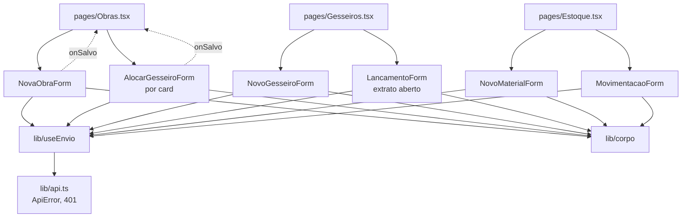

# Front — Formulários Design

**Spec**: `.claude/specs/features/front-formularios/spec.md`
**Status**: Approved (arquitetura "1 componente por formulário" escolhida pelo usuário em 2026-10-07)

---

## Architecture Overview

Cada formulário é um componente isolado em `apps/web/src/components/forms/`. Ele recebe por props os
dados de que precisa (ex.: lista de gesseiros, id da obra) e um callback `onSalvo()`. Ele mesmo monta o
corpo, chama `api.post` e trata `enviando`/`erro`. A página continua dona das listas: passa
`onSalvo={carregar}` e faz re-fetch depois do sucesso, o mesmo padrão de `concluir()`.

Duas peças compartilhadas evitam repetição:

- `lib/corpo.ts`: funções puras que convertem os valores do `<input>` (sempre string) para o formato
  que o `ValidationPipe` aceita (FRM-12).
- `lib/useEnvio.ts`: hook com `enviando`, `erro` e `enviar(fn)`. Desabilita o botão (FRM-11) e captura a
  mensagem de `ApiError` sem resetar o estado do formulário (FRM-10).



Nenhuma rota nova é criada e `App.tsx`/`Layout.tsx` não mudam, então não há conflito com `front-dashboard-resumo`.

---

## Code Reuse Analysis

### Existing Components to Leverage

| Component | Location | How to Use |
| --- | --- | --- |
| Cliente HTTP `api.post` + `ApiError` | `apps/web/src/lib/api.ts` | Única forma de chamar a API; a mensagem de `ApiError` já junta os arrays do `class-validator` |
| Tipos de domínio | `apps/web/src/types.ts` | `FormaPagamento`, `Gesseiro`, `Obra`, `Material`, `StatusObra` tipam props e corpos |
| Padrão de re-fetch | `Obras.tsx` `carregar()`/`concluir()` | `onSalvo` aponta para a função de carregar de cada página |
| Padrão de erro | `<p className="erro">` nas páginas | Os formulários exibem o próprio `erro` com a mesma classe |
| Markup de formulário | `apps/web/src/pages/Login.tsx` | `<form onSubmit>` + `<label>` envolvendo `<input>` (CSS já existe para `label`/`input`) |
| Estilo de teste | `apps/web/src/components/StatusBadge.test.tsx` | `render`/`screen` do Testing Library, nomes de teste em português |
| `rotuloStatus` | `apps/web/src/components/StatusBadge.tsx` | Rótulo da obra no seletor de `MovimentacaoForm` (opcional) |

### Integration Points

| System | Integration Method |
| --- | --- |
| `POST /obras` | `NovaObraForm` → corpo `CreateObraDto` |
| `POST /obras/:id/gesseiros` | `AlocarGesseiroForm` → corpo `AlocacaoGesseiroDto` |
| `POST /gesseiros` | `NovoGesseiroForm` → corpo `CreateGesseiroDto` |
| `POST /gesseiros/:id/lancamentos` | `LancamentoForm` → `{ tipo, valor, descricao? }` |
| `POST /estoque/materiais` | `NovoMaterialForm` → corpo `CreateMaterialDto` (backend ainda `NotImplemented`) |
| `POST /estoque/movimentacoes` | `MovimentacaoForm` → corpo `CreateMovimentacaoDto` (backend ainda `NotImplemented`) |
| `GET /gesseiros` | `Obras.tsx` passa a buscar também os gesseiros, uma vez, para alimentar os seletores |
| `GET /obras` | `Estoque.tsx` passa a buscar as obras para o seletor opcional da `SAIDA` |

---

## Components

### corpo (helpers)

- **Purpose**: Converter valores de input para o formato do DTO (FRM-12).
- **Location**: `apps/web/src/lib/corpo.ts`
- **Interfaces**:
  - `numero(valor: string): number` — `Number(valor)`; usado em obrigatórios (o `required` garante que não está vazio)
  - `numeroOpcional(valor: string): number | undefined` — `undefined` quando `valor.trim() === ''`
  - `textoOpcional(valor: string): string | undefined` — `undefined` quando vazio após `trim()`
  - `semVazios<T extends object>(obj: T): Partial<T>` — remove chaves com `undefined` (o `JSON.stringify` já omite, mas a função deixa explícito e testável)
- **Dependencies**: nenhuma
- **Reuses**: —

### useEnvio (hook)

- **Purpose**: Estado de envio compartilhado (FRM-10, FRM-11).
- **Location**: `apps/web/src/lib/useEnvio.ts`
- **Interfaces**:
  - `useEnvio(): { enviando: boolean; erro: string | null; enviar: (fn: () => Promise<void>) => Promise<boolean> }`
  - `enviar` zera `erro`, liga `enviando`, executa `fn`. Se der certo, retorna `true`. Se houver erro, guarda `e.message` (ou um texto padrão) e retorna `false`. `enviando` sempre volta a `false`. Quem chama só limpa o formulário quando recebe `true`.
- **Dependencies**: React
- **Reuses**: o mesmo `e instanceof Error ? e.message : '...'` usado nas páginas

### NovaObraForm

- **Purpose**: Criar obra (FRM-01..04).
- **Location**: `apps/web/src/components/forms/NovaObraForm.tsx`
- **Interfaces**: `props { gesseiros: Gesseiro[]; onSalvo: () => void | Promise<void> }`
- **Comportamento**:
  - Campos: `titulo`*, `clienteNome`*, `valorTotal`* (`type="number" min=0 step=0.01`), `descricao`, `clienteTelefone`, `endereco`, `plantaBaixaUrl` (`type="url"`).
  - Pagamento: select `forma` com a opção vazia "Sem pagamento definido". `parcelas` (`min=1 step=1`) e `valorEntrada` (`min=0`) só aparecem quando há forma escolhida.
  - Equipe: linhas `{ chave, gesseiroId, valorCombinado, funcao }`. A `chave` é interna e **não vai no corpo**. Cada select lista `gesseiros.filter(g => g.ativo)`, menos os ids já escolhidos em outras linhas. Botões "Adicionar gesseiro" / "Remover".
  - Corpo: `montarCorpoObra(estado)`, função pura exportada e testável sem render.
- **Dependencies**: `api`, `useEnvio`, `corpo`
- **Reuses**: `FormaPagamento`, `Gesseiro` de `types.ts`

### AlocarGesseiroForm

- **Purpose**: Alocar ou atualizar um gesseiro numa obra existente (FRM-05).
- **Location**: `apps/web/src/components/forms/AlocarGesseiroForm.tsx`
- **Interfaces**: `props { obraId: string; gesseiros: Gesseiro[]; onSalvo: () => void | Promise<void> }`
- **Comportamento**: select (apenas ativos), `valorCombinado`*, `funcao`. Chama `POST /obras/${obraId}/gesseiros`. O `Obras.tsx` decide se renderiza: só para `ORCAMENTO`/`FECHADA`/`ANDAMENTO` (AD-005).
- **Dependencies**: `api`, `useEnvio`, `corpo`

### NovoGesseiroForm

- **Purpose**: Cadastrar gesseiro (FRM-06).
- **Location**: `apps/web/src/components/forms/NovoGesseiroForm.tsx`
- **Interfaces**: `props { onSalvo: () => void | Promise<void> }`
- **Comportamento**: `nome`* (`minLength=3`), `telefone`, `chavePix` → `POST /gesseiros`.

### LancamentoForm

- **Purpose**: Registrar vale/pagamento (FRM-07).
- **Location**: `apps/web/src/components/forms/LancamentoForm.tsx`
- **Interfaces**: `props { gesseiroId: string; onSalvo: () => void | Promise<void> }`
- **Comportamento**: select `tipo` com exatamente as opções `VALE` e `PAGAMENTO`, `valor`* (`min=0.01`), `descricao` → `POST /gesseiros/${gesseiroId}/lancamentos`. `Gesseiros.tsx` só renderiza com extrato aberto e passa `onSalvo={() => abrirExtrato(id)}`.

### NovoMaterialForm

- **Purpose**: Cadastrar material (FRM-08).
- **Location**: `apps/web/src/components/forms/NovoMaterialForm.tsx`
- **Interfaces**: `props { onSalvo: () => void | Promise<void> }`
- **Comportamento**: `nome`* (`minLength=2`), `unidade`*, `estoqueMinimo` (`numeroOpcional`) → `POST /estoque/materiais`.

### MovimentacaoForm

- **Purpose**: Registrar entrada/saída (FRM-09).
- **Location**: `apps/web/src/components/forms/MovimentacaoForm.tsx`
- **Interfaces**: `props { materiais: Material[]; obras: Obra[]; onSalvo: () => void | Promise<void> }`
- **Comportamento**: `materialId`*, `tipo`* (`ENTRADA`/`SAIDA`), `quantidade`* (`min=0.01`), `observacao`. O select `obraId` só aparece quando o tipo é `SAIDA`. Ao trocar para `ENTRADA`, o `obraId` é limpo e não vai no corpo.

### Integração nas páginas (modificações)

- `Obras.tsx`: busca `GET /gesseiros` uma vez. Renderiza `NovaObraForm` atrás de um botão "Nova obra" (toggle `mostrarForm`), no lugar do TODO. O `onSalvo` faz `setFiltro('TODAS')` e depois `carregar()`. Atenção: quando o filtro já é `TODAS`, o `useEffect` não dispara de novo, então o `carregar()` precisa ser chamado direto. Cada card aberto renderiza `AlocarGesseiroForm`.
- `Gesseiros.tsx`: extrai o fetch para `carregar()` e renderiza `NovoGesseiroForm` no cabeçalho. Guarda o id selecionado e renderiza `LancamentoForm` dentro do card do extrato.
- `Estoque.tsx`: extrai `carregar()`, busca `GET /obras` e renderiza `NovoMaterialForm` + `MovimentacaoForm`.
- `index.css`: adiciona estilo para `select`/`textarea` (hoje só existe para `label`/`input`) e uma classe `.formulario` (grid simples).

---

## Data Models

Corpos enviados (espelham os DTOs; nada além destes campos):

```typescript
interface CorpoNovaObra {
  titulo: string; clienteNome: string; valorTotal: number;
  descricao?: string; clienteTelefone?: string; endereco?: string; plantaBaixaUrl?: string;
  pagamento?: { forma: FormaPagamento; parcelas?: number; valorEntrada?: number };
  gesseiros?: Array<{ gesseiroId: string; valorCombinado: number; funcao?: string }>;
}
interface CorpoAlocacao { gesseiroId: string; valorCombinado: number; funcao?: string }
interface CorpoGesseiro { nome: string; telefone?: string; chavePix?: string }
interface CorpoLancamento { tipo: 'VALE' | 'PAGAMENTO'; valor: number; descricao?: string }
interface CorpoMaterial { nome: string; unidade: string; estoqueMinimo?: number }
interface CorpoMovimentacao {
  materialId: string; tipo: 'ENTRADA' | 'SAIDA'; quantidade: number;
  obraId?: string; observacao?: string;
}
```

`gesseiros` vazio é omitido (`undefined`), não enviado como `[]`. As duas formas funcionam no backend; omitir mantém o corpo mínimo.

---

## Error Handling Strategy

| Error Scenario | Handling | User Impact |
| --- | --- | --- |
| 400/404/409 da API | `useEnvio` guarda `ApiError.message`, e o estado do form fica intacto | Mensagem em `.erro` dentro do form, dados preservados (FRM-10) |
| 401 | `lib/api.ts` já faz logout; o form mostra a mensagem como qualquer erro | "Sessao expirada..." e a próxima navegação vai para o login |
| Falha de rede (fetch rejeita) | Mesmo caminho: `e.message` ou o texto padrão "Erro ao salvar" | Mensagem, dados preservados |
| Campo obrigatório vazio | `required` do HTML5 impede o `onSubmit` | Balão nativo do navegador, sem request |
| Duplo clique em salvar | `disabled={enviando}` | Segundo clique ignorado (FRM-11) |
| Backend de estoque ainda `NotImplemented` (501) | Mesmo caminho de erro | Mensagem "criarMaterial ainda nao implementado", que é aceitável até a EST ser entregue |

---

## Risks & Concerns

| Concern | Location (file:line) | Impact | Mitigation |
| --- | --- | --- | --- |
| `import.meta.env` em `lib/api.ts` com ts-jest em `module: commonjs` | `apps/web/src/lib/api.ts:6`, `apps/web/tsconfig.jest.json` | Importar o `api` real num teste pode quebrar a compilação (TS1343). **Não verificado**: hoje nenhum teste importa `api.ts` | Todo teste de form usa `jest.mock('../../lib/api', () => ({ api: { post: jest.fn() } }))` com factory, sem carregar o módulo real. A primeira task de form valida esse padrão; se falhar, a correção vai para `jest.config.cjs`/`tsconfig.jest.json` dentro dessa task |
| Sem `@testing-library/user-event` instalado | `apps/web/package.json` | Interação nos testes fica limitada | Usar `fireEvent` (vem com `@testing-library/react`); não adicionar dependência |
| Backend aceita alocar inativo e alocar em obra finalizada | `apps/api/src/obras/obras.service.ts:94` | Swagger ainda consegue | Fica no front (AD-004/005); registrado como risco, sem mudança de backend nesta spec |
| Gesseiro duplicado em `POST /obras` vira 500 | `apps/api/src/obras/obras.service.ts:29` | 500 genérico | O front impede duplicatas no seletor (FRM-04) |
| `GesseirosService.findAll` sem filtro de `ativo` | `apps/api/src/gesseiros/gesseiros.service.ts:31` | Inativos chegariam nos seletores | Filtro no cliente (AD-004) |
| `useEffect([filtro])` não re-dispara se o filtro já é `TODAS` | `apps/web/src/pages/Obras.tsx:35` | A obra nova não apareceria | `onSalvo` chama `carregar()` explicitamente quando o filtro já é `TODAS` |
| Estoque backend `NotImplemented` | `apps/api/src/estoque/estoque.service.ts:39` | FRM-08/09 não demonstráveis de ponta a ponta | Componentes e testes (com API mockada) podem ser feitos, mas o Independent Test manual só depois da EST. As tasks dessas stories ficam numa fase separada, marcada como bloqueada |
| Sem lint script em `apps/web` | `apps/web/package.json` | O gate de lint do CI é `--if-present` e passa vazio | O gate Build usa `npm run build` (`tsc --noEmit` + vite) como checagem de tipos |

---

## Tech Decisions

| Decision | Choice | Rationale |
| --- | --- | --- |
| Montagem do corpo | Função pura `montarCorpo*` exportada por form (só o da obra é não trivial) | Permite testar FRM-12 sem render e mantém o componente fino |
| Formulário visível | Botão "Nova obra"/"Novo gesseiro"/"Novo material" alterna a exibição; alocação e lançamento ficam sempre visíveis onde fazem sentido | Não poluir as listas; segue o TODO das páginas |
| Seletor de obra na saída de estoque | Lista todas as obras de `GET /obras` | Simples; um filtro por status pode vir depois |

Decisões de nível de projeto desta feature já registradas: AD-004 e AD-005 em `.claude/specs/STATE.md`.
