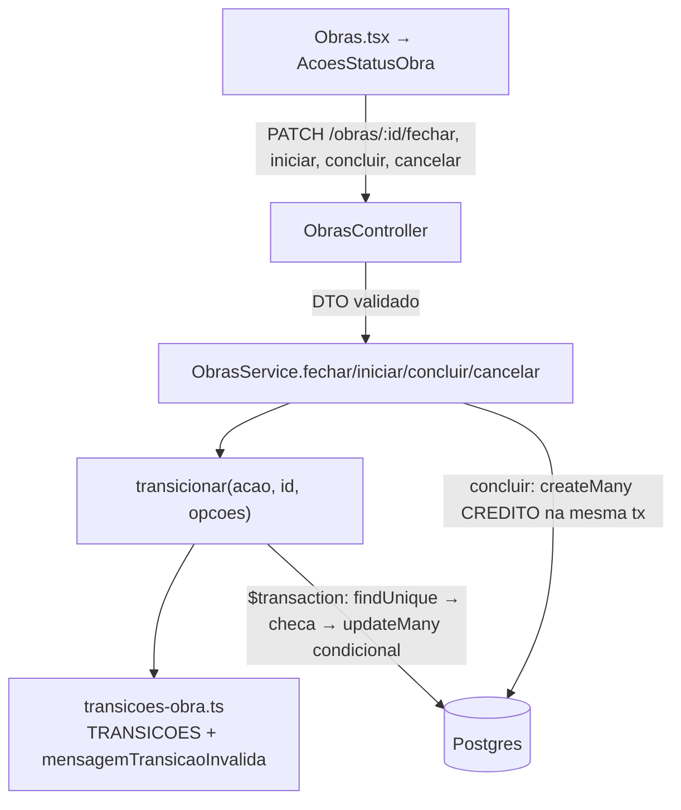

# Obras — Transições de Status Design

**Spec**: `.claude/specs/features/obras-transicoes-status/spec.md`
**Status**: Approved (2026-10-29)

---

## Architecture Overview

A regra de "de onde para onde" fica numa tabela pura (`transicoes-obra.ts`). O `ObrasService` ganha um
método privado `transicionar()` que aplica qualquer transição do mesmo jeito, dentro de uma
`$transaction`:

1. lê a obra (404 se não existe);
2. confere se o status atual é origem válida da ação (400 com a mensagem padrão se não for);
3. roda a pré-condição da ação, se houver (iniciar exige equipe);
4. faz um `updateMany` **condicional** (`where: { id, status: { in: origens } }`);
5. se o `updateMany` não mudou nenhuma linha (`count === 0`), outra chamada mudou o status no meio:
   relê o status e responde o mesmo 400 de transição inválida.

Os quatro métodos públicos (`fechar`, `iniciar`, `concluir`, `cancelar`) só dizem a ação, os dados
extras (`dataInicio`, `dataConclusao`, `motivoCancelamento`) e o que fazer depois da troca
(`concluir` cria os créditos na mesma transação).



**Por que o `updateMany` condicional resolve a concorrência:** no Postgres (READ COMMITTED), a
segunda transação que tenta atualizar a mesma linha espera a primeira terminar e reavalia o `where`.
Como o status já não é a origem, ela atualiza 0 linhas, não cria créditos e recebe o 400. Não precisa
de lock explícito (TRN-07).

---

## Code Reuse Analysis

### Existing Components to Leverage

| Component | Location | How to Use |
| --- | --- | --- |
| `ObrasService.concluir()` | `apps/api/src/obras/obras.service.ts:146` | Vira um caso de `transicionar('concluir')`; a criação dos créditos (`createMany`) é mantida, agora lendo a equipe dentro da transação |
| `findOne` / mensagem 404 | `apps/api/src/obras/obras.service.ts:71` | Mesmo texto `Obra <id> nao encontrada` para as transições |
| `ValidationPipe` com `forbidNonWhitelisted` | `apps/api/src/main.ts:18` | Tirar `status` do `CreateObraDto` já faz `POST`/`PATCH` com `status` responderem 400 (TRN-06); `UpdateObraDto` herda via `PartialType(OmitType(...))` |
| Padrão de teste com Prisma mockado e `$transaction` executando o callback | `apps/api/src/obras/obras.service.spec.ts:13` | Testes de `transicionar`; o mock ganha `updateMany` e `obraGesseiro.count` |
| `test/app.e2e-spec.ts` | `apps/api/test/` | Base do e2e de concorrência (sobe o `AppModule` real) |
| `StatusBadge`, `lib/status.ts` (`rotulo`, `STATUS_FUNIL`) | `apps/web/src/` | Rótulos e cores do status no card; o mapa "próxima ação por status" entra em `lib/status.ts` |
| Padrão de erro da página (`setErro`) | `apps/web/src/pages/Obras.tsx:70` | Erro de fechar/iniciar/concluir vai para o `erro` da página (P1 AC9) |
| `STATUS_SEM_EDICAO` | `apps/api/src/obras/materiais-previstos.service.ts:11` | Nada muda: obra cancelada ou concluída já não edita previstos |

### Integration Points

| System | Integration Method |
| --- | --- |
| Agente de estoque / reservas | A reserva só conta obras `FECHADA`/`ANDAMENTO` (`ferramentas-agente.ts`, `previsao-estoque.service.ts`). Ao cancelar ou concluir, a reserva some sozinha porque é derivada. Nenhum código do agente muda |
| Gesseiros | `STATUS_EM_ABERTO` (`gesseiros.service.ts:14`) continua igual; o extrato só ganha `CREDITO` pela conclusão |
| Dashboard | `GET /obras/resumo` não muda; as colunas "Fechadas" e "Em andamento" passam a receber obras pela UI |
| Banco | Migration nova: `Obra.motivoCancelamento String?` |
| Seed | Grava `status` direto pelo Prisma, sem passar pelo DTO: não muda |

---

## Components

### `transicoes-obra.ts` (novo, puro)

- **Purpose**: Tabela de transições válidas e mensagem de erro padrão.
- **Location**: `apps/api/src/obras/transicoes-obra.ts`
- **Interfaces**:
  - `type AcaoObra = 'fechar' | 'iniciar' | 'concluir' | 'cancelar'`
  - `TRANSICOES: Record<AcaoObra, { de: StatusObra[]; para: StatusObra }>`
  - `mensagemTransicaoInvalida(acao: AcaoObra, status: StatusObra): string` → `Não é possível <acao> uma obra com status <STATUS>` (mensagem nova: com acento)
- **Dependencies**: só o enum `StatusObra` do Prisma.
- **Reuses**: nada; é a fonte única da regra do funil.

### `ObrasService` (alterado)

- **Purpose**: Expor as quatro transições.
- **Location**: `apps/api/src/obras/obras.service.ts`
- **Interfaces**:
  - `fechar(id): Promise<Obra>` — `ORCAMENTO → FECHADA` (TRN-01)
  - `iniciar(id): Promise<Obra>` — `FECHADA → ANDAMENTO`, grava `dataInicio`; 400 `A obra precisa de pelo menos um gesseiro alocado para ser iniciada` sem equipe (TRN-02)
  - `concluir(id): Promise<Obra>` — `ANDAMENTO → CONCLUIDA`, grava `dataConclusao`, um `CREDITO` por gesseiro, tudo na mesma transação (TRN-03)
  - `cancelar(id, motivo): Promise<Obra>` — `ORCAMENTO|FECHADA|ANDAMENTO → CANCELADA`, grava `motivoCancelamento`, nenhum lançamento (TRN-09)
  - `private transicionar(acao, id, { dados?, validar?, depois? })` — o fluxo da Architecture Overview; devolve a obra com o `include` padrão
  - `removerGesseiro(obraId, gesseiroId)` — **sem mudança de regra de status**: continua removendo em qualquer status em aberto, inclusive o último gesseiro de obra `ANDAMENTO` (TRN-08, definido pelo usuário; teste de regressão). Passa a ler a obra (`findOne`, 404 `Obra <id> nao encontrada`) e a alocação antes de apagar: alocação inexistente → 404 `Gesseiro <gesseiroId> não está alocado nesta obra` (TRN-12)
- **Dependencies**: `PrismaService`, `transicoes-obra.ts`.
- **Reuses**: `include` padrão, padrão de exceções Nest.

### DTOs (alterados/novos)

- `CreateObraDto`: **remove** `status`. `UpdateObraDto` herda a remoção. Obra nova nasce com o default `ORCAMENTO` do schema (TRN-06).
- `CancelarObraDto` (novo, em `dto/cancelar-obra.dto.ts`): `motivo: string` com `@Transform` de trim, `@IsString()`, `@Length(3, 500)`. Motivo ausente, curto ou longo → 400 do `ValidationPipe` (P2 AC3).

### `ObrasController` (alterado)

- `PATCH :id/fechar`, `PATCH :id/iniciar`, `PATCH :id/cancelar` (corpo `CancelarObraDto`), com `@ApiOperation`. O `PATCH :id/concluir` já existe. Controller fino: só delega.

### `AcoesStatusObra` (novo, web)

- **Purpose**: Os botões de transição de um card e o formulário de cancelamento.
- **Location**: `apps/web/src/components/AcoesStatusObra.tsx`
- **Interfaces**: `props { obra: Obra; onAlterada: () => void; onErro: (mensagem: string) => void }`
  - Mostra só o botão de avanço do status atual: "Cliente aprovou" (`ORCAMENTO`), "Iniciar obra" (`FECHADA`), "Concluir obra" (`ANDAMENTO`); nada em `CONCLUIDA`/`CANCELADA` (P1 AC6).
  - Em `FECHADA` sem gesseiro (`obra.gesseiros` vazio), "Iniciar obra" fica desabilitado e o texto "Aloque pelo menos um gesseiro para iniciar" aparece logo abaixo (P1 AC6). O texto some quando a lista recarrega com equipe.
  - "Concluir obra" chama `window.confirm` antes (P1 AC7). O texto vem de `textoConfirmacaoConclusao(obra)` (`lib/status.ts`): uma linha `<nome> — <moeda(valorCombinado)>` por item de `obra.gesseiros`, ou `Nenhum gesseiro alocado: nenhum crédito será gerado.` (TRN-11). Usa só os dados que `GET /obras` já devolve (`gesseiros.gesseiro.nome`, `valorCombinado`): nenhuma rota nova.
  - "Cancelar obra" em `ORCAMENTO`/`FECHADA`/`ANDAMENTO` abre no card um formulário com "Motivo" obrigatório. O erro do cancelamento fica no próprio formulário e o motivo digitado é mantido (P2 AC5–7).
  - Desabilita os botões do card enquanto uma chamada está em andamento (edge case de duplo clique).
  - Sucesso → `onAlterada()` (a página recarrega com o filtro atual, P1 AC8). Erro de fechar/iniciar/concluir → `onErro(mensagem)` (P1 AC9).
- **Reuses**: `api.patch`, classes `.btn`/`.card-acoes`/`.erro` existentes.

### `Obras.tsx` e `lib/status.ts` (alterados, web)

- `Obras.tsx` troca o bloco do "Concluir obra" (`Obras.tsx:155-165`) por `<AcoesStatusObra>` e mostra `Motivo do cancelamento: …` no card `CANCELADA` (P2 AC8).
- `lib/status.ts` ganha `textoConfirmacaoConclusao(obra: Obra): string` e `acaoDeAvanco: Partial<Record<StatusObra, { acao: 'fechar' | 'iniciar' | 'concluir'; rotulo: string }>>`.
- `types.ts`: `Obra.motivoCancelamento?: string | null`.

---

## Data Models

### `Obra` (alterado)

```prisma
model Obra {
  // ...campos atuais
  /// Motivo informado ao cancelar (3 a 500 caracteres, sem espaços nas pontas)
  motivoCancelamento String?
}
```

Migration `obra_motivo_cancelamento`: só `ADD COLUMN "motivoCancelamento" TEXT` (nullable). Nenhum dado
existente muda.

---

## Error Handling Strategy

| Error Scenario | Handling | User Impact |
| --- | --- | --- |
| Obra inexistente em qualquer transição | 404 `Obra <id> nao encontrada` | Mensagem no `erro` da página |
| Status atual não é origem da ação (inclusive repetir a ação) | 400 `Não é possível <acao> uma obra com status <STATUS>`, sem efeito | Mensagem no `erro` da página; o card fica como estava |
| Corrida: outra chamada mudou o status no meio | `updateMany` com `count === 0` → relê o status → mesmo 400 | Quem chegou depois vê a mensagem; nenhum crédito duplicado |
| Iniciar sem equipe | 400 `A obra precisa de pelo menos um gesseiro alocado para ser iniciada` | Pela UI não acontece: o botão fica desabilitado. Pela API (ou com a lista desatualizada), a mensagem aparece no `erro` da página |
| Concluir obra `ANDAMENTO` sem equipe (todos removidos depois de iniciar) | Conclui normalmente, com zero lançamentos | Ninguém recebe crédito por ela |
| Falha ao criar os créditos na conclusão | A `$transaction` desfaz a troca de status | Obra continua `ANDAMENTO`, sem crédito parcial |
| `status` no corpo de `POST`/`PATCH /obras` | 400 do `ValidationPipe` (`property status should not exist`) | Só via Swagger; a UI não manda `status` |
| Motivo ausente, < 3 ou > 500 caracteres depois do trim | 400 do `ValidationPipe` | Mensagem no formulário de cancelamento, motivo preservado |

---

## Risks & Concerns

| Concern | Location (file:line) | Impact | Mitigation |
| --- | --- | --- | --- |
| Check-then-act fora da transação em `concluir()` | `apps/api/src/obras/obras.service.ts:147-164` | Dois cliques simultâneos geram créditos em dobro | `transicionar()` com `updateMany` condicional dentro da `$transaction`; e2e com dois `concluir` em paralelo (TRN-07) |
| Mensagens atuais do `concluir` mudam | `obras.service.ts:157,161`; `obras.service.spec.ts:185` | O teste "nao credita duas vezes" espera `Esta obra ja foi concluida` | O teste passa a esperar `Não é possível concluir uma obra com status CONCLUIDA`, a mensagem da spec (mudança de contrato aprovada, já acentuada) |
| `removerGesseiro` sem 404 | `obras.service.ts:128-133` | Alocação inexistente vira erro do Prisma (P2025 → 500) | Aprovado: 404 `Gesseiro <gesseiroId> não está alocado nesta obra` (TRN-12) |
| Crédito só para quem está alocado na conclusão | `obras.service.ts:146-185`, `:128-133` | Gesseiro removido antes de concluir não recebe crédito e a alocação some (hard delete), sem registro de que trabalhou ali | Fora de escopo (spec futura "remanejamento de gesseiros"). Mitigação nesta feature: a confirmação do "Concluir obra" lista quem vai receber (TRN-11) |
| e2e grava no banco de dev | `apps/api/test/obras-transicoes.e2e-spec.ts` | Dados de teste poluem o banco local e entrariam numa análise do agente | Cria só registros com prefixo `[e2e]` (título da obra, nome do gesseiro) e apaga num `afterAll`, que roda mesmo se o teste falhar, filtrando **só** pelo prefixo (lançamentos → obras, que levam as alocações em cascata → gesseiros). Roda dentro do container (`docker exec gesso_api npm run test:e2e`). Aviso no STATE: não rodar perto de uma demonstração do agente |
| Obras legadas `CONCLUIDA` sem créditos | dados de dev | Nenhum (fora de escopo na spec) | Nada a fazer |

---

## Tech Decisions

| Decision | Choice | Rationale |
| --- | --- | --- |
| Onde fica a regra do funil | Tabela pura `TRANSICOES` + `transicionar()` privado | Escolhido pelo usuário em 2026-10-29: regra num lugar só, testável sem mock |
| Concorrência | `updateMany` condicional ao status de origem, dentro da `$transaction`, sem lock | Postgres reavalia o `where` da segunda transação; confirmado na spec |
| Créditos | Equipe lida **dentro** da transação, depois da troca de status | Mesma visão de dados da troca; não usa uma leitura feita antes da corrida |
| Testes | Unit (service, tabela, DTO via `class-validator`) + 1 e2e no Postgres do Docker | Escolhido pelo usuário em 2026-10-29: o e2e prova a concorrência de verdade |
| Trim do motivo | `@Transform` no DTO, antes da validação | O `ValidationPipe` usa `transform: true`; "3 a 500 depois do trim" fica no DTO e o service grava o valor já limpo |

> **AD-007 (proposta para o STATE):** o status da `Obra` só muda pelos endpoints de transição
> (`/fechar`, `/iniciar`, `/concluir`, `/cancelar`); nenhum DTO genérico aceita `status`. Toda
> transição usa update condicional ao status de origem dentro de `$transaction`.
