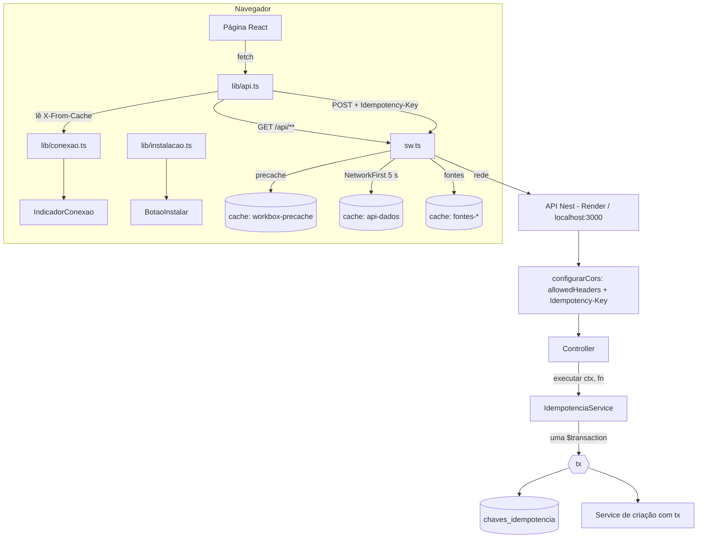
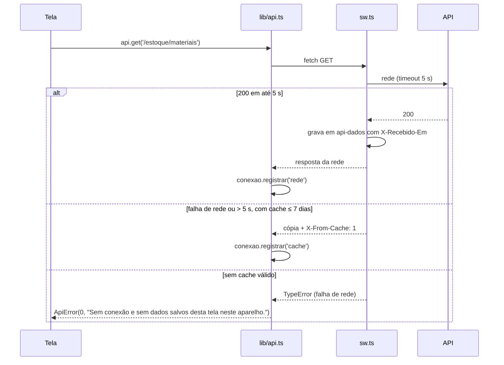
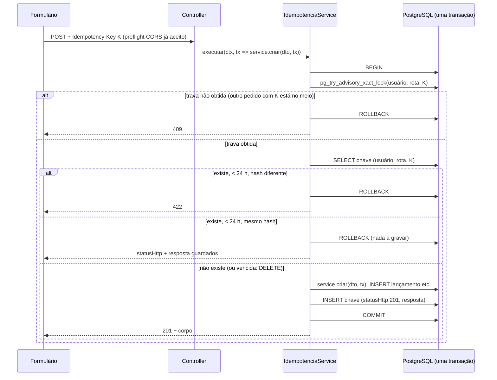

# PWA Instalável e Responsivo Design

**Spec**: `.claude/specs/features/pwa-instalavel-responsivo/spec.md`
**Status**: Approved (2026-11-09, com os ajustes de CORS, transação única e cron)

Abordagens escolhidas pelo usuário (2026-11-09):

- **Service worker**: `vite-plugin-pwa` em modo `injectManifest`, com `src/sw.ts` próprio montado
  com módulos do Workbox. A alternativa `generateSW` (só configuração) não cumpre OFF-04 nem OFF-10.
- **Idempotência**: tabela nova, gravada **na mesma transação do PostgreSQL** que a entidade criada.
  Se a API cair no meio, o banco desfaz as duas, e nunca fica chave presa nem lançamento sem chave.
  A primeira versão deste design usava um interceptor que gravava a chave fora da transação; o
  usuário recusou por causa da chave presa por 24 h.
- **Reenvio editado**: o 422 bloqueia, avisa e gera uma chave nova (IDP-07).
- **API**: origens separadas, como hoje (Vercel + Render). O SW cobre a origem do `VITE_API_URL`.

---

## Architecture Overview



O que roda onde:

- **Leitura offline (OFF-\*)**: só no SW e no `lib/api.ts`. As páginas continuam chamando `api.get`
  e recebem a resposta da rede ou do cache sem distinguir. A marcação de cache passa por
  `lib/conexao.ts`, que alimenta o ícone.
- **Idempotência (IDP-\*)**: o front gera e guarda a chave (`useEnvio`). No backend, o controller
  passa a criação para `IdempotenciaService.executar()`, que abre uma `$transaction` e dentro dela
  decide entre replay, 422 e 409, chama o service de criação com o `tx` e grava a chave. Os 5
  métodos de criação passam a aceitar `tx`, no padrão que o `validarItens(itens, tx)` já usa.
- **Responsividade (RSP-\*)**: CSS (`index.css`) e um ajuste de estrutura no `Layout.tsx`.
  A verificação é o script de auditoria, porque o jsdom não calcula layout.

### Fluxo do GET com o SW ativo



### Fluxo do POST idempotente



Por que funciona:

- **Queda no meio**: tudo está numa transação. Se a API cai ou o handler lança erro, o PostgreSQL
  desfaz a entidade e a chave juntas. Não existe estado "em processamento" gravado, então a chave
  nunca fica presa. Um erro (400/404/409 de negócio) também não grava a chave, e o reenvio com a
  mesma chave é processado de novo.
- **Simultâneo (IDP-04)**: o 409 vem da trava consultiva de transação (`pg_try_advisory_xact_lock`),
  não de uma linha gravada. Enquanto o pedido A está dentro da transação, o B não consegue a trava
  e recebe 409 na hora. A trava se solta sozinha no `COMMIT`, no `ROLLBACK` ou quando a conexão cai.
  Quando A termina, um reenvio de B pega a trava, vê a chave gravada por A e recebe o replay.
- **Rede de segurança**: o índice único `(usuarioId, rota, chave)` continua lá. Se mesmo assim dois
  `INSERT` colidirem (`P2002`), a resposta é 409.

---

## Code Reuse Analysis

### Existing Components to Leverage

| Component | Location | How to Use |
| --- | --- | --- |
| Cliente HTTP único | `apps/web/src/lib/api.ts` | Ponto único para: detectar falha de rede (status 0), ler `X-From-Cache`, mandar `Idempotency-Key`, limpar o cache no 401 |
| `useEnvio` | `apps/web/src/lib/useEnvio.ts` | Ganha a chave de idempotência e as mensagens de 409/422/rede; os 5 formulários de criação já usam o hook |
| `Layout` | `apps/web/src/components/Layout.tsx` | Mesmo `<nav>`: sidebar no desktop e barra inferior no mobile, por CSS. Recebe `IndicadorConexao` e `BotaoInstalar` |
| `Icone` | `apps/web/src/components/Icone.tsx` | Novos nomes `wifi-off` e `instalar` no mesmo padrão SVG |
| SVG da marca | `apps/web/index.html` (favicon) | Fonte dos ícones PNG do manifest |
| Padrão `carregar()` + `useEffect` | `pages/*.tsx` | `useAoReconectar(carregar)` chama a mesma função no evento `online` (OFF-15) |
| `JwtAuthGuard` global + `req.user.id` | `apps/api/src/auth/jwt.strategy.ts` | O decorator `@ContextoIdempotencia()` lê `req.user.id` (o guard já rodou) como dono da chave |
| `ScheduleModule` / `@nestjs/schedule@6.1.3` | `apps/api/src/app.module.ts`, `apps/api/package.json:35` | Já instalado e registrado (usado pelo agendador do agente); um `@Cron` de hora em hora apaga as chaves vencidas. Nenhuma dependência nova |
| Cliente de transação por parâmetro | `apps/api/src/obras/materiais-previstos.service.ts:14`, `:25` (`validarItens(itens, tx: ClientePrisma = this.prisma)`) | Mesmo padrão nos 5 métodos de criação: `tx` opcional, com `this.prisma` como padrão |
| Garantia de saldo dentro da transação | `apps/api/src/estoque/estoque.service.ts:80-110` | O corpo da `$transaction` de `movimentar()` vira `movimentarCom(tx, dto)`, chamado direto quando já há `tx` |
| `PrismaService` | `apps/api/src/prisma/` | Acesso à tabela nova |
| Script da auditoria de 2026-11-09 | scratchpad (`audit.mjs`) | Base de `apps/web/scripts/audit-responsive.mjs` |
| Estilo de teste | `apps/api/src/obras/obras.service.spec.ts`, `apps/web/src/**/*.test.tsx` | Mesmo padrão (Prisma mockado na API, Testing Library no web) |

### Integration Points

| System | Integration Method |
| --- | --- |
| Build do Vite | `VitePWA({ strategies: 'injectManifest', srcDir: 'src', filename: 'sw.ts', injectRegister: false, manifest: {...} })` em `vite.config.ts` |
| Registro do SW | Manual em `main.tsx`: `if (import.meta.env.PROD && 'serviceWorker' in navigator) navigator.serviceWorker.register('/sw.js', { scope: '/' })`. Sem `virtual:pwa-register`, para não herdar o reload automático (UPD-03) |
| Vercel | `vercel.json` continua reescrevendo tudo para `index.html`. `sw.js` e `manifest.webmanifest` são arquivos reais em `dist/` e a Vercel os serve antes do rewrite. Conferir no Tasks se `sw.js` sai com `Cache-Control` que não prenda versão velha |
| Banco | Migration nova `chaves_idempotencia` (Prisma) |
| CORS (IDP-09) | O `enableCors` sai de `main.ts:11-14` para `src/cors.ts` (`configurarCors(app)`), com `allowedHeaders: ['Content-Type', 'Authorization', 'Idempotency-Key']` explícito. `main.ts` e o teste e2e chamam a mesma função; hoje o e2e (`test/app.e2e-spec.ts:20`) monta a app sem CORS e não pegaria uma regressão. Ver componente `configurarCors` |
| Origem do `vite preview` | `CORS_ORIGIN` padrão (`docker-compose.yml:34`, `.env.example:13`) passa de `http://localhost:5173` para `http://localhost:5173,http://localhost:4173`. Sem isso, o `vite preview` (onde o SW roda e a auditoria é feita) é bloqueado pelo CORS |

---

## Components

### Front: estrutura e responsividade

#### `Layout` (alterado)

- **Purpose**: Casca da aplicação: sidebar (> 900px) ou topo + barra inferior (≤ 900px).
- **Location**: `apps/web/src/components/Layout.tsx`
- **Interfaces**: `abas` ganha `rotuloCurto` ("Geral", "Obras", "Equipe", "Estoque"). Cada `NavLink`
  renderiza `<span class="rotulo">` e `<span class="rotulo-curto">`; o CSS mostra um ou outro.
  O topo ganha `<IndicadorConexao />` e `<BotaoInstalar />` ao lado do avatar. `sair()` vira
  `async` e espera `encerrarSessao()`.
- **Dependencies**: `lib/conexao.ts`, `lib/instalacao.ts`, `lib/sessao.ts`
- **Reuses**: o `<nav>` e o `NavLink` atuais (RSP-05 sem mudança visual no desktop)

#### CSS (alterado), `apps/web/src/index.css`

| Req | Regra |
| --- | --- |
| RSP-01/02 | `.app { grid-template-columns: 240px minmax(0, 1fr) }` e, no mobile, `minmax(0, 1fr)`. `.grade`, `.lista-alertas`: `minmax(min(300px, 100%), 1fr)`; `.grade-resumo`, `.formulario`, `fieldset`: o mesmo com 200/220px. `overflow-wrap: anywhere` em `.card h2/h4`, `.cliente`, `.pessoa` (nomes de 120 caracteres); `overflow-wrap: break-word` em `.tabela td`, que já rola por dentro e não deve partir palavras no meio |
| RSP-03 | ≤ 900px: `.nav { position: fixed; inset: auto 0 0 0; display: grid; grid-template-columns: repeat(4, 1fr) }`, `.nav-link` em coluna (ícone sobre rótulo), `.rotulo { display: none }`, `.rotulo-curto { display: inline }` |
| RSP-04 | ≤ 900px: `.app { grid-template-rows: auto 1fr }` (o topo para de esticar); `.sidebar { height: calc(56px + env(safe-area-inset-top)); padding-top: env(safe-area-inset-top) }`; `.marca-texto { display: none }`; `.usuario` à direita (`margin-left: auto`) |
| RSP-06 | `--altura-nav: 64px`; `.conteudo { padding-bottom: calc(var(--altura-nav) + env(safe-area-inset-bottom) + 16px) }` ≤ 900px; `.nav { padding-bottom: env(safe-area-inset-bottom) }` |
| RSP-07 | `@media (max-width: 900px), (pointer: coarse) { input, select, textarea { font-size: 16px } }` |
| RSP-08 | ≤ 900px: `min-height: 44px; min-width: 44px` em `.nav-link`, `.btn-sair`, `.btn-instalar`, `.chip`, `.btn-detalhes`, `.btn-icone` ("Ver silenciados", 38×38 na auditoria), `.card-obra summary` (com `display: flex; align-items: center`) e `.linha-form .btn-texto` |
| RSP-09 | `.lista-pessoas li { cursor: pointer }`; o `onClick` sobe do botão para o `li` (o botão continua lá para teclado e leitor de tela) |
| RSP-11 | `.app, .login { min-height: 100vh; min-height: 100dvh }` (a segunda linha sobrepõe onde houver suporte) |
| RSP-12 | `index.html`: `viewport-fit=cover` no `<meta name="viewport">`; os `env(safe-area-inset-*)` acima |
| Hover | `.card-obra:hover` (translate) dentro de `@media (hover: hover)` para não "grudar" no toque |

#### `Gesseiros` (alterado)

- **Purpose**: RSP-09 e RSP-10.
- **Location**: `apps/web/src/pages/Gesseiros.tsx`
- **Interfaces**: `li onClick={() => abrirExtrato(id)}`. Depois de carregar o extrato,
  `if (window.matchMedia('(max-width: 760px)').matches) refExtrato.current?.scrollIntoView({ block: 'start', behavior: 'smooth' })`.
  O `scroll-margin-top` do card desconta a altura do topo.

### Front: conexão e cache

#### `lib/conexao.ts` (novo)

- **Purpose**: Guarda o estado "dados possivelmente desatualizados" e avisa quem escuta.
- **Interfaces**:
  - `registrarOrigem(origem: 'rede' | 'cache'): void`: chamado pelo `api.ts` a cada GET 200
  - `estaDesatualizado(): boolean`: `!navigator.onLine || ultimaOrigem === 'cache'`
  - `assinar(fn: () => void): () => void`: também dispara nos eventos `online`/`offline`
  - `useDesatualizado(): boolean`: hook com `useSyncExternalStore`
  - `useAoReconectar(fn: () => void): void`: chama `fn` no evento `online` (OFF-15)
- **Reuses**: nada; módulo pequeno sem dependência

Regra do OFF-06/07: o ícone acende quando o navegador está offline ou a última resposta GET veio
do cache, e apaga quando chega a primeira resposta GET da rede.

#### `IndicadorConexao` (novo)

- **Location**: `apps/web/src/components/IndicadorConexao.tsx`
- **Interfaces**: sem props. Renderiza `null` ou
  `<span class="indicador-conexao" role="img" aria-label="Dados possivelmente desatualizados" title="Dados possivelmente desatualizados"><Icone nome="wifi-off" /></span>`,
  com cor `var(--alerta)`.

#### `lib/sessao.ts` (novo)

- **Purpose**: Fim e início de sessão com limpeza do cache (OFF-11, OFF-12).
- **Interfaces**:
  - `NOME_CACHE_API = 'api-dados'`, constante compartilhada com o `sw.ts`
  - `limparCacheApi(): Promise<void>`: `if ('caches' in window) await caches.delete(NOME_CACHE_API)`, com erro engolido
  - `encerrarSessao(): Promise<void>`: `auth.logout()` + `limparCacheApi()`
  - `iniciarSessao(resposta: LoginResponse): Promise<void>`: `limparCacheApi()` + `setToken` + `setUsuario`
- **Dependencies**: `lib/api.ts` (`auth`)

#### `lib/api.ts` (alterado)

- `request()` envolve o `fetch` em `try/catch`. Um `TypeError` (falha de rede, inclusive
  "SW sem cache") vira `ApiError(MENSAGEM, 0)`, com mensagem por método:
  - GET: "Sem conexão e sem dados salvos desta tela neste aparelho." (OFF-05)
  - escrita: "Sem conexão: não foi possível confirmar o envio. Tente de novo; o mesmo lançamento não será duplicado." (OFF-08)
- GET 200: `registrarOrigem(resposta.headers.get('X-From-Cache') === '1' ? 'cache' : 'rede')`.
- 401: `await encerrarSessao()` antes de lançar o erro (OFF-11).
- `post<T>(caminho, corpo?, opcoes?: { idempotencyKey?: string })` acrescenta o cabeçalho `Idempotency-Key`.
- 409 e 422 continuam `ApiError` com `status`. Quem traduz para as mensagens do IDP-07/08 é o `useEnvio`.

#### `useEnvio` (alterado)

- **Interfaces**: `useEnvio(recurso?: string)` retorna `{ enviando, erro, enviar, chave }`.
  - `chave`: `useState(() => gerarUuid())`. É criada quando o formulário monta, ou seja, quando
    abre (todos são montados condicionalmente; o `LancamentoForm` tem `key={gesseiro.id}`).
  - `recurso`: identifica para onde o formulário envia. Quando muda sem o formulário desmontar, a
    chave é trocada, sem depender do `key` de quem chama. O `LancamentoForm` passa `gesseiroId`. O
    `MovimentacaoForm` passa o `materialId` do `inicial`, porque o "Resolver" de outro alerta troca
    o pré-preenchimento com o formulário já aberto (`Estoque.tsx:100` não tem `key`). Os outros 3
    não apontam para um recurso e não passam nada. Na montagem, o hook não troca a chave.
  - `enviar(fn: (chave: string) => Promise<void>)`. No sucesso, troca a chave (IDP-01). Com
    `status 422`: mensagem do IDP-07 e troca a chave. Com `status 409` e `codigo === 'EM_PROCESSAMENTO'`: mensagem do IDP-08; outro 409, mensagem da API; em todo 409 mantém
    a chave. Com `status 0`: mensagem do `api.ts` (OFF-08) e mantém a chave. Os campos nunca são
    limpos aqui; quem chama só limpa quando recebe `true` (como hoje).
- **Location**: `apps/web/src/lib/useEnvio.ts`; `gerarUuid()` em `lib/uuid.ts`
- `gerarUuid()`: `crypto.randomUUID()` quando existe. Senão, um UUID v4 a partir de
  `crypto.getRandomValues`, porque `randomUUID` só existe em contexto seguro e o teste no celular
  pela rede local (`http://192.168.x.x:5173`) não é seguro.
- **Formulários alterados** (passam `chave` no `api.post`): `NovoGesseiroForm`, `LancamentoForm`,
  `NovaObraForm`, `NovoMaterialForm`, `MovimentacaoForm`. `AlocarGesseiroForm` não muda (não está
  na lista do IDP-01).

#### `Login` (alterado)

- `status 0` vira "Sem conexão. Conecte-se à internet para entrar." (OFF-13). `email` continua no
  estado; o campo de senha é esvaziado no erro de rede (a senha não é guardada).
- No sucesso: `await iniciarSessao(resposta)` antes do `navigate` (OFF-12).

#### `useAoReconectar` nas páginas (alterado)

`Dashboard`, `Obras`, `Gesseiros` (lista + extrato aberto), `Estoque` e `AlertasEstoque` chamam
`useAoReconectar(carregar)`. `carregar()` só troca o estado de dados; formulários abertos têm estado
próprio e não são remontados (OFF-15).

### Front: instalação

#### `lib/instalacao.ts` (novo)

- **Purpose**: Captura `beforeinstallprompt` o mais cedo possível e expõe o estado da instalação.
- **Interfaces**:
  - `iniciarCapturaInstalacao(): void`: chamado no topo do `main.tsx`, antes do `render`. Registra
    `beforeinstallprompt` (com `preventDefault()` e o evento guardado) e `appinstalled` (limpa)
  - `useInstalacao(): { modo: 'prompt' | 'ios' | null; instalar(): Promise<void> }`
    - `null` quando `matchMedia('(display-mode: standalone)').matches` ou `navigator.standalone`
      (PWA-08), ou quando não há evento e não é iOS (PWA-09)
    - `'prompt'` quando há evento guardado (PWA-05). `instalar()` chama `prompt()`, espera
      `userChoice` e descarta o evento nos dois resultados (PWA-06/07)
    - `'ios'` quando é Safari do iOS fora do standalone (PWA-10): `/iPhone|iPad|iPod/` no UA, ou
      `MacIntel` com `maxTouchPoints > 1`, e sem `CriOS|FxiOS|EdgiOS`
- **Location**: `apps/web/src/lib/instalacao.ts`

#### `BotaoInstalar` (novo)

- **Location**: `apps/web/src/components/BotaoInstalar.tsx`
- **Interfaces**: sem props. `modo === null`: não renderiza. `'prompt'`: botão "Instalar app" que
  chama `instalar()`. `'ios'`: o mesmo botão abre um popover (mesmo estilo do `.painel-silenciados`)
  com "Toque em Compartilhar e depois em Adicionar à Tela de Início". No mobile, ícone + rótulo
  acessível; no desktop, ícone + texto na área do usuário.

### Front: PWA

#### `vite.config.ts` (alterado)

```ts
VitePWA({
  strategies: 'injectManifest',
  srcDir: 'src',
  filename: 'sw.ts',
  injectRegister: false,            // registro manual (UPD-03)
  devOptions: { enabled: false },   // PWA-04
  includeAssets: ['apple-touch-icon.png'],
  manifest: {
    id: '/', name: 'Gesso Manager', short_name: 'Gesso', lang: 'pt-BR',
    start_url: '/', scope: '/', display: 'standalone',
    theme_color: '#0f2a24', background_color: '#f3f5f4',
    icons: [
      { src: 'icone-192.png', sizes: '192x192', type: 'image/png' },
      { src: 'icone-512.png', sizes: '512x512', type: 'image/png' },
      { src: 'icone-512-maskable.png', sizes: '512x512', type: 'image/png', purpose: 'maskable' },
    ],
  },
  injectManifest: { globPatterns: ['**/*.{js,css,html,png,svg,webmanifest}'] },
})
```

`build.rollupOptions` não muda. Uma regra no Tasks confere que o build gera **um único chunk JS**
(sem `import()`/`React.lazy`), para o UPD-04.

#### `src/sw.ts` (novo)

- **Purpose**: Precache da casca, fallback de navegação, cache de dados e de fontes, atualização.
- **Interfaces** (eventos do SW, sem API pública):
  - `self.skipWaiting()` no `install` e `clientsClaim()` (UPD-02)
  - `precacheAndRoute(self.__WB_MANIFEST)` e `cleanupOutdatedCaches()` (OFF-01)
  - `registerRoute(new NavigationRoute(createHandlerBoundToURL('/index.html'), { denylist: [/^\/api\//] }))` (OFF-01: qualquer rota do app abre offline e `/api/**` nunca recebe o HTML)
  - `registerRoute(ehRequisicaoDeDados, new NetworkFirst({ cacheName: NOME_CACHE_API, networkTimeoutSeconds: 5, plugins: [new CacheableResponsePlugin({ statuses: [200] }), new ExpirationPlugin({ maxEntries: 200, maxAgeSeconds: SETE_DIAS }), pluginRecebimento] }))` (OFF-02/03/09/14)
  - Fontes: `fonts.googleapis.com` com `StaleWhileRevalidate` (`fontes-css`); `fonts.gstatic.com` com `CacheFirst` (`fontes-arquivos`, `statuses: [0, 200]`, 1 ano, 30 entradas)
- **Location**: `apps/web/src/sw.ts`, com `/// <reference lib="webworker" />`. Fica fora do
  `tsconfig.json` principal (que tem `lib: DOM`); o `tsc --noEmit` do build usa um
  `tsconfig.sw.json` próprio com `lib: ["ES2020", "WebWorker"]`.

#### `src/pwa/regras-cache.ts` (novo, puro e testável)

- **Purpose**: A lógica que o spec exige do SW, isolada do runtime do Workbox para rodar no Jest
  (`@jest-environment node`, que tem `Request`/`Response`).
- **Interfaces**:
  - `ehRequisicaoDeDados({ request, url }, origensApi: string[]): boolean`: `GET` +
    `url.origin ∈ origensApi` + `pathname` começa com `/api/` + não começa com `/api/auth/` (OFF-02/09)
  - `pluginRecebimento: WorkboxPlugin`
    - `cacheWillUpdate({ response })`: devolve uma cópia com `X-Recebido-Em: Date.now()` (só 200)
    - `cachedResponseWillBeUsed({ cachedResponse })`: `null` se `agora - X-Recebido-Em > 7 dias`
      (OFF-10, contado pela data de recebimento). Senão, cópia com `X-From-Cache: 1` (OFF-04)
  - `origensApi(viteApiUrl: string | undefined, self: string): string[]`: `[self, new URL(viteApiUrl).origin]`, sem repetição
- O `ExpirationPlugin` continua para o limite de 200 (OFF-14) e para a limpeza do IndexedDB. A
  regra de 7 dias não depende do cabeçalho `Date`: em resposta cross-origin ele não é visível ao SW
  (não é CORS-safelisted), e foi por isso que entrou o `X-Recebido-Em`.

#### Ícones, `apps/web/scripts/gerar-icones.mjs` (novo)

- Renderiza o SVG da marca com `puppeteer-core` (já aprovado) e grava `public/icone-192.png`,
  `icone-512.png`, `icone-512-maskable.png` (fundo cheio `#1f6f5c`, desenho dentro dos 80% centrais)
  e `apple-touch-icon.png` (180). Roda uma vez; os PNGs entram no git. Não é parte do build.
- `index.html` ganha `<link rel="apple-touch-icon" href="/apple-touch-icon.png">` e
  `<meta name="apple-mobile-web-app-title" content="Gesso">` (PWA-02).

#### Auditoria, `apps/web/scripts/audit-responsive.mjs` (novo)

- Evolução do script de 2026-11-09. Pré-requisitos: `vite preview` (porta 4173) e a API rodando.
  Faz login pela API, percorre as 14 telas/estados × 6 larguras e mede. São as 11 da auditoria de
  2026-11-09, mais três estados do agente de estoque: o painel "Silenciados" aberto e a justificativa
  de um alerta aberta (os dois no `/dashboard`), e o `/estoque` aberto pelo "Resolver" de um alerta
  (`?alerta=&material=&quantidade=`, com aviso e movimentação preenchida).
- **Dados montados, não supostos**: antes de medir, a auditoria roda
  `docker exec gesso_api node scripts/fixture-auditoria.mjs preparar`
  (`apps/api/scripts/fixture-auditoria.mjs`, Prisma Client do container), que cria um alerta
  `ATIVO` e um `DISPENSADO` em materiais `[audit]`, ligados a uma `AnaliseEstoque` datada de
  2000-01-01. Essa análise nunca vira a "última análise" nem afeta o catch-up, e o agente LLM não é
  chamado. Ao fim, `limpar` roda num `finally`. Cada estado é conferido como montado antes da
  medição. Um estado que não monta sai `NAO_MONTADO` e reprova a auditoria; não existe "pulado".
- Medidas:
  - `scrollWidth == innerWidth` (RSP-01)
  - `.tabela-wrap` com `scrollWidth > clientWidth` e página sem transbordo (RSP-02)
  - altura do topo ≤ 64 (RSP-04) e `.nav` com `position: fixed` + 4 links (RSP-03)
  - último filho de `.conteudo` acima da `.nav` ao rolar até o fim (RSP-06)
  - `font-size` ≥ 16 nos campos (RSP-07)
  - alvos do RSP-08 ≥ 44×44
  - `scrollIntoView` do extrato em 360px (RSP-10)
- Sai com código ≠ 0 se alguma medida falhar e grava screenshots em `apps/web/.audit/` (no
  `.gitignore`). Comando: `npm run audit:responsive`.
- Usa o Chrome instalado: `CHROME_PATH`, com padrão `C:/Program Files/Google/Chrome/Application/chrome.exe`.

### Backend: idempotência

Por que não um interceptor: a chave e a entidade precisam estar no **mesmo** `tx`. O projeto passa o
cliente da transação por parâmetro (`validarItens(itens, tx)`), e o Prisma 5.22 não aninha
transações interativas: um `tx` não tem `$transaction`. Um interceptor só conseguiria entregar o
`tx` ao service por um contexto implícito (`AsyncLocalStorage` + extensão do Prisma), e o
`this.prisma.$transaction` que já existe dentro de `movimentar()` abriria uma segunda transação,
quebrando a atomicidade sem aviso. Por isso o controller chama `executar()` de forma explícita e
cada método de criação recebe o `tx`.

#### `IdempotenciaModule` (novo)

- **Location**: `apps/api/src/idempotencia/`
  - `idempotencia.module.ts`: `@Global()`, exporta o service
  - `idempotencia.service.ts`
  - `contexto-idempotencia.decorator.ts`: param decorator `@ContextoIdempotencia()`
  - `api-idempotencia.decorator.ts`: `ApiIdempotencia()` = `ApiHeader({ name: 'Idempotency-Key', required: false, description: 'UUID; reenvio com a mesma chave devolve a resposta original' })`
  - `hash-corpo.ts`: `hashCorpo(body): string`, SHA-256 de um JSON canônico (chaves ordenadas)
  - `tipos.ts`: `ClientePrisma = Prisma.TransactionClient | PrismaService` e `ContextoIdempotencia`
  - specs: `idempotencia.service.spec.ts` (Prisma mockado, padrão `obras.service.spec.ts`),
    `contexto-idempotencia.decorator.spec.ts`, `hash-corpo.spec.ts` e o e2e com banco (abaixo)

#### `@ContextoIdempotencia()` (param decorator)

- Lê do request: `Idempotency-Key`, `req.user.id`, `rota = ${method} ${req.path}` (o path real, então
  a mesma chave em `/gesseiros/A/lancamentos` e `/gesseiros/B/lancamentos` são rotas diferentes) e
  `hashCorpo(req.body)`.
- Sem cabeçalho: devolve `null` (IDP-06).
- Cabeçalho que não é UUID: `BadRequestException('Idempotency-Key deve ser um UUID.')`.
- Tipo: `ContextoIdempotencia = { chave: string; usuarioId: string; rota: string; hashCorpo: string } | null`

#### `IdempotenciaService`

- `executar<T>(ctx: ContextoIdempotencia, criar: (tx: ClientePrisma) => Promise<T>): Promise<T | unknown>`
  - `ctx === null`: `return criar(this.prisma)`. O service usa o próprio caminho de hoje, inclusive
    a `$transaction` interna do `movimentar()` (IDP-06).
  - Senão, `this.prisma.$transaction(async (tx) => { ... }, { timeout: 15_000 })`:
    1. `SELECT pg_try_advisory_xact_lock(hashtextextended(${usuarioId}||' '||${rota}||' '||${chave}, 0)) AS ok`
       por `tx.$queryRaw`. Se for `false`: `ConflictException({ statusCode: 409, message: 'Este envio ainda está sendo processado.', error: 'Conflict', codigo: 'EM_PROCESSAMENTO' })` (IDP-04); o mesmo corpo no `P2002`
    2. `tx.chaveIdempotencia.findUnique({ where: { usuarioId_rota_chave } })`
       - mais de 24 h: `delete` e segue como nova (IDP-05)
       - `hashCorpo` diferente: `UnprocessableEntityException('Esta Idempotency-Key já foi usada com outros dados.')` (IDP-03)
       - mesmo hash: `return linha.resposta` (IDP-02, sem gravar nada)
    3. `const resultado = await criar(tx)`
    4. `const resposta = JSON.parse(JSON.stringify(resultado))`: exatamente o que vai para a rede (`Decimal` vira string, `Date` vira ISO)
    5. `tx.chaveIdempotencia.create({ data: { chave, usuarioId, rota, hashCorpo, statusHttp: 201, resposta } })`
    6. `return resposta`; o `COMMIT` grava a entidade e a chave juntas
  - `P2002` na criação da chave (colisão que passou pela trava): `ConflictException` (409)
  - Qualquer erro em 3: a transação faz `ROLLBACK` e o erro sobe como hoje (a chave não é gravada)
- `@Cron(CronExpression.EVERY_HOUR) limparVencidas()`: `deleteMany({ where: { criadoEm: { lt: agora - 24 h } } })`
- Status do replay: só sucesso é gravado, e todas as 5 rotas respondem 201 (padrão do `@Post` do
  Nest, sem `@HttpCode` nelas). O replay sai pelo mesmo `@Post`, então volta 201 (IDP-02).
  `statusHttp` fica na tabela para auditoria e para um `@HttpCode` futuro.

#### Controllers (alterados)

As 5 rotas ganham `@ApiIdempotencia()` e o `@ContextoIdempotencia()`, e continuam finas (só delegam):

```ts
@Post(':id/lancamentos')
@ApiIdempotencia()
registrarLancamento(
  @Param('id') id: string,
  @Body() dto: CreateLancamentoDto,
  @ContextoIdempotencia() ctx: ContextoIdempotencia,
) {
  return this.idempotencia.executar(ctx, (tx) =>
    this.gesseirosService.registrarLancamento(id, dto, tx),
  );
}
```

Rotas: `POST /gesseiros`, `POST /gesseiros/:id/lancamentos`, `POST /obras`, `POST /estoque/materiais`,
`POST /estoque/movimentacoes`.

#### Services de criação (alterados: só aceitam `tx`)

Todos com `tx: ClientePrisma = this.prisma`, e toda leitura e escrita do método passa a usar o `tx`:

| Método | Mudança |
| --- | --- |
| `GesseirosService.create(dto, tx)` | `tx.gesseiro.create` |
| `GesseirosService.registrarLancamento(id, dto, tx)` | `findOne(id, tx)`, `tx.obra.findUnique`, `tx.lancamento.create` (`findOne` ganha o mesmo `tx` opcional) |
| `ObrasService.create(dto, tx)` | `validarItens(itens, tx)` (já aceita) e `tx.obra.create` |
| `EstoqueService.criarMaterial(dto, tx)` | `tx.material.create`. O `P2002` do nome repetido continua virando o 409 de hoje; como o erro sobe, a transação de fora faz `ROLLBACK` (dentro de uma transação aborted o PostgreSQL não aceitaria mais comandos, e nenhum é feito) |
| `EstoqueService.movimentar(dto, tx?)` | O corpo da `$transaction` vira `private movimentarCom(tx, dto)`. Com `tx`, chama `movimentarCom(tx, dto)` direto; sem `tx`, mantém `this.prisma.$transaction((t) => this.movimentarCom(t, dto))`. A guarda atômica de saldo (`updateMany ... gte`) não muda |

Os testes atuais dos services continuam passando sem `tx` (o padrão é `this.prisma`). Novos casos
garantem que, com `tx`, nenhuma chamada vai para `this.prisma` (o mock de `prisma` e o de `tx` são
objetos diferentes).

#### `configurarCors` (novo), `apps/api/src/cors.ts`

- **Purpose**: Uma única configuração de CORS, usada por `main.ts` e pelo teste e2e (IDP-09).
- **Interfaces**: `configurarCors(app: INestApplication): void`, que chama
  `app.enableCors({ origin: process.env.CORS_ORIGIN?.split(',') ?? '*', credentials: true, allowedHeaders: ['Content-Type', 'Authorization', 'Idempotency-Key'] })`.
- `origin` e `credentials` ficam como estão em `main.ts:11-14`. `allowedHeaders` passa a ser
  explícito: hoje o pacote `cors` reflete o que o navegador pede, então já funciona, mas uma lista
  explícita documenta o contrato e é o que o teste trava.

#### Teste e2e da idempotência, `apps/api/test/idempotencia.e2e-spec.ts` (novo)

Com o banco de dev, no mesmo padrão `[e2e]` + `afterAll` do Handoff:

- **Preflight**: `OPTIONS /api/gesseiros/:id/lancamentos` com `Origin: http://localhost:5173`,
  `Access-Control-Request-Method: POST`, `Access-Control-Request-Headers: content-type,authorization,idempotency-key`.
  Espera 204 e `Access-Control-Allow-Headers` contendo `Idempotency-Key` (sem diferenciar
  maiúsculas) (IDP-09).
- **Replay**: dois POST de vale com a mesma chave e o mesmo corpo. Um único `Lancamento` no banco e
  as duas respostas iguais (IDP-02).
- **Outro corpo**: mesma chave e outro valor dá 422, e continua um lançamento só (IDP-03).
- **Simultâneos**: `Promise.all` de dois POST com a mesma chave dá um 201, um 409 e um lançamento.
  Para tornar o teste determinístico, o primeiro pedido segura a trava por um gancho de teste
  (`criar` mockado com atraso via `overrideProvider`) (IDP-04).
- **Rollback**: um `criar` que lança erro depois de inserir o lançamento não deixa nem lançamento
  nem chave no banco. Um reenvio com a mesma chave então grava normalmente (prova que a chave não
  fica presa).
- **Sem cabeçalho**: dois POST sem chave criam dois lançamentos (IDP-06).

A app do teste chama `configurarCors(app)`, o que hoje não acontece em `test/app.e2e-spec.ts`.

---

## Data Models

### `ChaveIdempotencia` (Prisma)

```prisma
/// Reenvio seguro de POST de criacao (spec pwa-instalavel-responsivo, IDP-01..09).
/// Gravada na MESMA transacao da entidade criada: so existe linha de envio concluido.
/// Linhas vivem 24 h; o cron de hora em hora apaga as vencidas.
model ChaveIdempotencia {
  id         String   @id @default(uuid())
  chave      String   @db.Uuid
  usuarioId  String
  rota       String
  hashCorpo  String   @db.Char(64)
  statusHttp Int
  resposta   Json
  criadoEm   DateTime @default(now())

  @@unique([usuarioId, rota, chave])
  @@index([criadoEm])
  @@map("chaves_idempotencia")
}
```

Não há coluna de status nem enum `PROCESSANDO`: o "em processamento" é a trava consultiva de
transação, que vive só enquanto a transação está aberta. `statusHttp` e `resposta` são obrigatórios
porque a linha só nasce junto com o sucesso.

**Relationships**: nenhuma FK. `usuarioId` vem do JWT. Uma FK para `usuarios` travaria a remoção de
usuário por causa de uma tabela que se apaga sozinha em 24 h; o índice único já garante o escopo
por usuário.

### Cache no navegador (Cache Storage)

| Cache | Conteúdo | Limites |
| --- | --- | --- |
| `workbox-precache-v2-*` | Build (HTML, JS, CSS, ícones, manifest) | Trocado a cada versão (`cleanupOutdatedCaches`) |
| `api-dados` | `GET /api/**` 200, chave = URL completa, com `X-Recebido-Em` | 200 entradas, 7 dias; apagado em login e logout |
| `fontes-css`, `fontes-arquivos` | Google Fonts | 1 ano, 30 entradas |

---

## Error Handling Strategy

| Error Scenario | Handling | User Impact |
| --- | --- | --- |
| GET sem rede, com cache ≤ 7 dias | SW entrega a cópia com `X-From-Cache: 1` | Dados aparecem; ícone vermelho |
| GET sem rede, sem cache | SW rejeita, `api.ts` gera `ApiError(0)` | `.erro` "Sem conexão e sem dados salvos desta tela neste aparelho." |
| API lenta (> 5 s) com cache | `NetworkFirst` entrega o cache; a resposta da rede, se chegar, atualiza o cache para a próxima vez | Dados do cache; ícone vermelho até a próxima resposta da rede |
| POST sem rede | `ApiError(0)`; `useEnvio` mantém a chave e os campos | Mensagem do OFF-08 |
| POST repetido (mesma chave e corpo) | `executar()` devolve o corpo guardado, com 201 | O formulário trata como sucesso: limpa e recarrega |
| POST com a mesma chave e outro corpo | 422; `useEnvio` troca a chave | Mensagem do IDP-07; campos mantidos |
| POST com a chave em uso por outro pedido | Trava não obtida, 409; `useEnvio` mantém a chave | Mensagem do IDP-08. A trava dura só o tempo da transação (segundos), então o "aguarde alguns segundos" é verdade |
| Service falha (400/404/409 de negócio, 500) | `ROLLBACK` da transação: nem entidade nem chave; o erro sobe | Mensagem da API, como hoje; reenviar com a mesma chave processa de novo |
| API cai no meio do POST | O PostgreSQL desfaz a transação e solta a trava quando a conexão cai | O front recebe erro de rede (OFF-08); o reenvio com a mesma chave grava uma vez só |
| Preflight CORS do POST | `allowedHeaders` inclui `Idempotency-Key` | Nenhum |
| Login sem rede | `ApiError(0)` | "Sem conexão. Conecte-se à internet para entrar."; e-mail mantido |
| 401 | `encerrarSessao()` limpa o token e o cache; o erro sobe | "Sessao expirada. Faca login novamente." (como hoje) |
| Navegador sem SW / sem Cache Storage | `register` e `caches` protegidos por `'serviceWorker' in navigator` / `'caches' in window` | App só online, como hoje |
| Cache cheio (QuotaExceeded) | O Workbox ignora a falha de gravação e entrega a resposta da rede | Nenhum |

---

## Risks & Concerns

| Concern | Location (file:line) | Impact | Mitigation |
| --- | --- | --- | --- |
| `movimentar()` abre a própria `$transaction`, e o Prisma não aninha transações interativas | `apps/api/src/estoque/estoque.service.ts:80` | Com `tx` de fora, um `this.prisma.$transaction` interno abriria uma segunda transação: a chave e a movimentação deixariam de ser atômicas, sem nenhum erro | Corpo extraído para `movimentarCom(tx, dto)`. Teste com `tx` exige que `prisma.$transaction` **não** seja chamado. O Tasks também roda `grep "this.prisma" ` nos 5 métodos para garantir que nenhuma chamada escapa do `tx` |
| Transação interativa mais longa que o padrão do Prisma (5 s) | `idempotencia.service.ts` (novo) | `POST /obras` com muitos previstos estoura o timeout e responde 500 | `timeout: 15_000` explícito; o `maxWait` padrão (2 s) basta para o pool do Render |
| A trava consultiva usa um hash de 64 bits do texto (usuário + rota + chave) | `idempotencia.service.ts` (novo) | Colisão entre chaves diferentes daria um 409 indevido | Probabilidade desprezível (64 bits, chaves que vivem segundos). O índice único continua sendo a garantia de não duplicar |
| Render free "dorme" e o primeiro GET passa de 5 s | `docs/ARQUITETURA.md:85` | Online, com a API acordando, a tela mostra o cache e o ícone vermelho | Comportamento correto pelo spec (API lenta = possivelmente desatualizado). A resposta tardia atualiza o cache; navegar de novo mostra o dado novo |
| Página antiga pede um chunk que não existe mais depois do deploy | `vite.config.ts` | Tela branca numa página aberta (quebra o UPD-04) | Sem `import()`/`React.lazy` (AD-010); o Tasks confere que `dist/assets` tem um único `.js` |
| `sw.js` com cache HTTP longo na Vercel | `apps/web/vercel.json` | Atualização demora a chegar | O navegador ignora cache HTTP > 24 h para SW; conferir o cabeçalho no Tasks e, se preciso, `headers` no `vercel.json` com `Cache-Control: no-cache` para `/sw.js` |
| `crypto.randomUUID` ausente em `http://IP-da-rede` | `lib/uuid.ts` (novo) | Formulário quebraria ao abrir no celular em dev | Fallback com `getRandomValues` (testado) |
| `auth.logout()` é síncrono e chamado em vários lugares | `apps/web/src/lib/api.ts:19` | Um logout que não limpe o cache quebra o OFF-11 | Todo logout passa por `encerrarSessao()`; `grep auth.logout` no Tasks garante que só `sessao.ts` chama `auth.logout` |
| Sem teste de componente do `Layout` hoje | `apps/web/src/components/Layout.tsx` | Troca de estrutura sem rede de segurança | Novo `Layout.test.tsx` (abas, rótulos, Sair limpa o cache, indicador, botão instalar) |
| `index.css` com 1196 linhas e media queries espalhadas | `apps/web/src/index.css:204`, `:425`, `:881`, `:1076`, `:1192` | Regra mobile nova colidindo com uma antiga | Bloco mobile único no fim do arquivo para as regras desta feature; a auditoria pega regressão |
| Feature paralela `obras-transicoes-status` (Tasks aprovadas, sem código) mexe nos mesmos arquivos | `apps/api/src/obras/obras.service.ts`, `obras.service.spec.ts`, `obras.controller.ts`, `apps/api/prisma/schema.prisma`, `apps/web/src/pages/Obras.tsx` | Conflito de merge e duas migrations criadas em paralelo | Ver "Revalidação contra a `main`" abaixo: as mudanças desta feature nesses arquivos são localizadas (T11: só `create()`; T14: só o `@Post()`; T6: só um model novo; T23: só uma linha em `Obras.tsx`). A feature que for mergeada depois faz rebase e regenera a própria migration por cima da outra |
| CORS e o `Idempotency-Key` | `apps/api/src/main.ts:11-14` | Sem `Idempotency-Key` em `allowedHeaders`, o navegador bloqueia todos os POST de criação no preflight. O e2e atual (`test/app.e2e-spec.ts:20`) não monta CORS e não pegaria isso | `configurarCors()` compartilhado por `main.ts` e e2e, com a lista explícita, e teste de preflight (IDP-09) |
| `CORS_ORIGIN` padrão só tem a porta 5173 | `docker-compose.yml:34`, `.env.example:13` | O `vite preview` (4173), onde o SW roda, é bloqueado pelo CORS; a auditoria e o teste offline falhariam | Padrão passa a `http://localhost:5173,http://localhost:4173`. Em produção, o `CORS_ORIGIN` do Render continua sendo a URL da Vercel |

---

## Tech Decisions

| Decision | Choice | Rationale |
| --- | --- | --- |
| Registro do SW | Manual em `main.tsx`, `injectRegister: false` | O `virtual:pwa-register` em `autoUpdate` recarrega a página ao ativar (proibido pelo UPD-03); em `prompt` ele espera `waiting`, que nunca ocorre com `skipWaiting` |
| Marcação "veio do cache" | Cabeçalho sintético `X-From-Cache` criado no SW | Resposta construída pelo SW é legível pela página mesmo vinda de outra origem |
| Idade do cache | `X-Recebido-Em` gravado pelo SW | `Date` não é visível em resposta cross-origin; o `ExpirationPlugin` só usa `Date` na leitura |
| Lógica do SW testável | `src/pwa/regras-cache.ts` puro + Jest `@jest-environment node` | O runtime do SW não roda no Jest; o que o spec exige fica fora dele |
| Mesmo `<nav>` em desktop e mobile | Um elemento, posição por CSS | Troca de largura sem remontar (Edge Case) e sem duplicar links |
| Escopo da chave | `(usuarioId, method + path real, chave)` | A mesma chave em outro recurso não colide |
| Chave e entidade | Mesma `$transaction`, com o `tx` passado explicitamente do controller ao service | Decisão do usuário: nenhuma chave presa e nenhum lançamento sem chave. Explícito em vez de `AsyncLocalStorage` porque é o padrão do projeto (`validarItens(itens, tx)`) e porque um contexto implícito esconderia a `$transaction` aninhada do `movimentar()` |
| "Em processamento" (409) | `pg_try_advisory_xact_lock` | Responde na hora, sem gravar estado. Um `INSERT` concorrente no índice único ficaria **esperando** o outro terminar e depois daria replay, nunca o 409 que o IDP-04 pede |
| Erro não é guardado | `ROLLBACK` leva a chave junto | Corrigir o motivo do 400 e reenviar com a mesma chave funciona |
| CORS | `allowedHeaders` explícito em `configurarCors()` | Contrato visível e testado (IDP-09) |
| Dependências | `vite-plugin-pwa@1.3.0`; `workbox-core`, `-precaching`, `-routing`, `-strategies`, `-expiration`, `-cacheable-response` `@7.4.1` (dev); `puppeteer-core@23.11.1` (dev). `@nestjs/schedule@6.1.3` já está instalado (`apps/api/package.json:35`), nada novo na API | Versões publicadas há mais de 2 semanas; os `workbox-*` são exigidos pelo `injectManifest`. O `puppeteer-core` 25 exige Node ≥ 22.12 e o container do web é `node:20-alpine`; a 23.11.1 aceita Node 18+ e foi a usada na auditoria de 2026-11-09 |

Decisões de projeto registradas em `.claude/specs/STATE.md`: **AD-009** (idempotência em POST de
criação) e **AD-010** (sem rotas lazy + sessão limpa o cache).

---

## Revalidação contra a `main` (2026-11-09, antes do L1)

**Base**: branch `feat/pwa-instalavel-responsivo` em `4fe273c`, a partir da `main` `8e99dc8` (= `origin/main`).

- **Código**: `git diff aa52d2a 8e99dc8` é vazio. A `main` é o merge da PR #7, cujo único commit novo
  é o `aa52d2a`, a base em que este design foi escrito. Agente de estoque, `SilenciadosEstoque`,
  `index.css` (1196 linhas), `estoque.service.ts` e `materiais-previstos.service.ts` já estavam na
  análise. Entre `aa52d2a` e `HEAD`, só mudaram os 4 arquivos de spec/STATE.
- **Referências conferidas na `main`**, todas válidas:

  | Referência | Encontrado |
  | --- | --- |
  | `estoque.service.ts:80` | `return this.prisma.$transaction(async (tx) => {` dentro de `movimentar()` |
  | `materiais-previstos.service.ts:14`, `:25` | `type ClientePrisma = Pick<PrismaService, 'material'>` e `validarItens(itens, tx: ClientePrisma = this.prisma)` |
  | `main.ts:11-14` | `enableCors({ origin, credentials })`, sem `allowedHeaders` |
  | `index.css:51-54` | `.app { grid-template-columns: 240px 1fr; min-height: 100vh }`; media queries em `:204`, `:425`, `:881`, `:1076` e `:1192` |
  | `docker-compose.yml:34`, `.env.example:13` | `CORS_ORIGIN` só com `http://localhost:5173` |
  | `apps/api/package.json:35` | `@nestjs/schedule` `6.1.3` |

  A estratégia da transação não muda. Nota: o `ClientePrisma` de `materiais-previstos.service.ts` é
  local e mais estreito (`Pick<…, 'material'>`). O `ClientePrisma` novo de `idempotencia/tipos.ts`
  (`Prisma.TransactionClient | PrismaService`) é compatível com ele, porque um `TransactionClient`
  tem `material`. Não é preciso mexer no tipo local.
- **ADs**: a `main` vai até a AD-008, e a AD-009 e a AD-010 só existem no commit `4fe273c`. Não há
  colisão nem renumeração.
- **Telas novas**: o `SilenciadosEstoque` (botão "Ver silenciados" + painel) e a justificativa do
  `CardAlertaEstoque` só aparecem com interação, e a auditoria de 2026-11-09 não os abria. Eles
  entraram no RSP-01 e na auditoria (14 estados), e o botão de 38×38 entrou no RSP-08. O `/estoque`
  vindo do "Resolver" de um alerta também entrou. Não há outra tela ou componente fora da lista:
  `components/` e `pages/` têm os mesmos 17 componentes já analisados.
- **`obras-transicoes-status`** (Tasks aprovadas, nenhum código na `main`):
  - **Idempotência (AD-009)**: aquela feature não cria POST de criação. As rotas novas são
    `PATCH /obras/:id/fechar`, `/iniciar`, `/concluir` e `/cancelar` e
    `DELETE /obras/:id/gesseiros/:gesseiro`. Elas já são seguras para reenvio pela AD-007: cada
    transição é um update condicional ao status de origem, e repetir dá 400 de transição inválida,
    sem efeito duplicado (sem crédito dobrado no `concluir`). Ficam fora do `Idempotency-Key`,
    conforme a AD-009, que vale para POST de criação. O único POST que ela toca, `POST /obras`, é só
    para tirar `status` do `CreateObraDto` (TRN-06), e isso não interfere no `executar()`, que recebe
    o corpo já validado pelo DTO.
  - **Arquivos em comum**:

    | Arquivo | Esta feature | `obras-transicoes-status` |
    | --- | --- | --- |
    | `apps/api/prisma/schema.prisma` + migrations | T6: model novo `ChaveIdempotencia` | T2: campo de cancelamento em `Obra` |
    | `apps/api/src/obras/obras.service.ts` (+ spec) | T11: só `create(dto, tx)` | T5–T9: métodos de transição |
    | `apps/api/src/obras/obras.controller.ts` | T14: só o `@Post()` | T10: rotas `PATCH` novas, `@Patch(':id/concluir')` muda |
    | `apps/web/src/pages/Obras.tsx` (+ test) | T23: uma linha `useAoReconectar(carregar)` | T15: botões de ação no card |
    | `apps/web/src/index.css` | T2–T4: grid, barra inferior, alvos | Estilos de `AcoesStatusObra` (se houver) |

    As mudanças desta feature nesses arquivos são localizadas e não tocam os métodos que a outra
    altera. O conflito esperado é textual, resolvível no rebase. Regras para quem mergear depois:
    (1) regenerar a própria migration por cima da outra (`prisma migrate dev`), nunca editar a
    migration já mergeada; (2) incluir os estados novos daquela feature (`AcoesStatusObra`,
    formulário de cancelamento) no `audit:responsive` e no RSP-08, conforme a nova assumption da spec.
